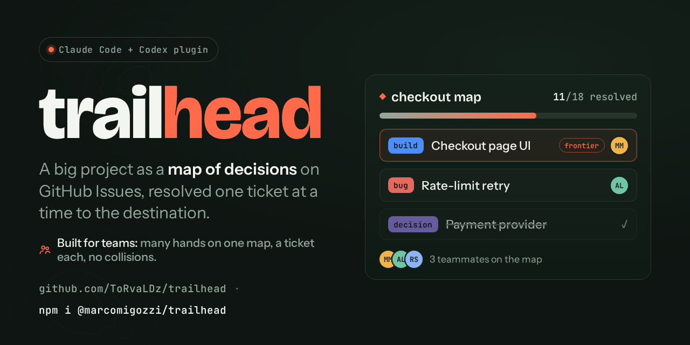
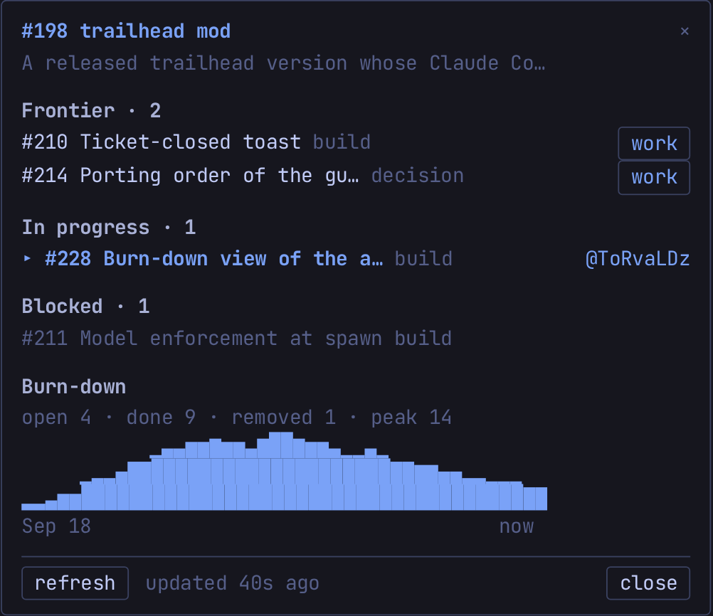

<div align="center">



# Trailhead

🇬🇧 [English](README.md) · 🇮🇹 **Italiano**

[](https://trailhead.marcomigozzi.it) [](https://github.com/ToRvaLDz/trailhead/actions/workflows/site-ci.yml) [](https://www.npmjs.com/package/@marcomigozzi/trailhead) [](LICENSE)   

</div>

**Avvia e conduci grandi progetti come una mappa di ticket su GitHub Issues, risolvendone uno alla volta finché la via verso la destination non è chiara.**

`trailhead` è una skill orchestratrice per coding agent, che gira su [Claude Code](https://docs.claude.com/en/docs/claude-code) e [Codex CLI](https://developers.openai.com/codex/cli) da un'unica sorgente. Dà a un'idea grande e nebbiosa un punto da cui partire (un *trailhead*) e un modo disciplinato per portarla fino a un risultato funzionante, con l'intero piano che vive sul tuo issue tracker invece che in file locali sparsi.

---

## 💡 Perché esiste trailhead

Due approcci al lavoro di progetto guidato dagli agenti risolvono ciascuno una metà del problema:

- **[Wayfinder](https://github.com/mattpocock/skills)** (di Matt Pocock) è brillante nell'*iniziare*. Trasforma un'idea informe in una **mappa condivisa di decision ticket sul tuo issue tracker**, denominati attraverso una vera conversazione di grilling, con una frontier visibile e una "fog of war" per ciò che non è ancora abbastanza nitido da pianificare. Risolvi una decision per sessione e la mappa cresce verso l'esterno. Ciò che deliberatamente non fa è *costruire*: pianifica, poi passa la mano (handoff).

- **GSD** (il workflow system [open-gsd](https://github.com/open-gsd/gsd-core)) è brillante nel *fare*. Il suo ciclo `discuss → plan → execute → verify`, i commit atomici e la cattura senza attrito rendono la costruzione vera e propria affidabile e revisionabile. Ma il suo stato vive in un albero locale `.planning/`, separato da dove il team può vederlo.

Lavorando su entrambi, uno schema continuava a ripresentarsi: **usa una mappa e un onboarding in stile Wayfinder per decidere la forma del lavoro, poi un motore in stile GSD per costruire ogni pezzo, senza mai lasciare l'issue tracker.** `trailhead` è quello schema trasformato in un insieme di skill a cluster coesi su un core condiviso, una sua interpretazione autonoma di entrambe le idee anziché un wrapper attorno all'una o all'altra.

> **trailhead è self-contained** nel senso che ha **zero dipendenze da plugin esterni**: gli agent di trailhead e i built-in dell'host vanno bene, e nessun'altra skill o plugin è richiesta. Wayfinder e GSD sono *ispirazione*, non dipendenze. Ogni tecnica che quei sistemi impacchettano come skill separata (grilling, TDD, debugging sistematico, codebase mapping, code review) è **integrata qui come protocollo inline**. Il core di trailhead non invoca nessun'altra skill; ogni tecnica del motore dispatcha al **proprio agent `trailhead-*`** (`trailhead-executor`, `trailhead-plan`, `trailhead-research`, `trailhead-code-review`, `trailhead-debug`, più `trailhead-fix` e `trailhead-codebase-map`), scritto una volta come file `agents/trailhead-*.md` versionato e **proiettato su ogni host** (su Codex diventa `~/.codex/agents/trailhead-*.toml` generato dalla stessa sorgente). Questi agent sono **thin** (identità + tool policy + un modello guidato dalla config, con il protocollo della tecnica iniettato allo spawn) e girano sul toolkit di subagent nativo dell'host (il tool `Agent` integrato di Claude Code, oppure il toolkit `multi_agent` di Codex). L'unica cosa da installare è trailhead stesso. C'è un'unica eccezione opt-in: i mockup hosted. `design: artifacts` usa il tool `Artifact` integrato in Claude Code (niente da installare), e `design: stitch` usa l'MCP Google Stitch (offerto come installazione una tantum). Vedi [Mockup prima del codice](#-mockup-prima-del-codice).

Le scelte di design che ne derivano:

- **Tutto vive su GitHub Issues.** La mappa è la parent issue; ogni ticket è una child issue; discussione, piano e verifica sono *commenti*. Non c'è alcuna directory `.planning/`: il repo contiene solo codice, e il piano è sempre visibile a chiunque abbia accesso al repo.
- **L'esecuzione avviene dentro la mappa.** A differenza del Wayfinder puro ("plan, don't do"), i build ticket si diplomano dalla fog e vengono eseguiti come figli della mappa. La destination è l'**artefatto funzionante** (un'app deployata), non un documento di specifica, anche se un progetto può ridefinire questo e fermarsi alla specifica.
- **Dai una mappa e torna dopo.** `/trailhead:auto` svuota una mappa o la whiteboard senza supervisione, in fino a quattro slot paralleli, e lascia un run report, i ticket che hanno bisogno di te e i commit locali da pushare. Vedi [Run autonoma](#-run-autonoma-auto).
- **Lean by default.** Il macchinario pesante (codebase mapping, debugging sistematico) gira una volta dove vale la pena; il ciclo per-ticket resta leggero.

- **Costruito per i team, perché il piano è condiviso.** Il tracker è l'unica fonte di verità, quindi la mappa è un **workspace condiviso**, non il file locale di una singola persona. Molte persone (e i loro agenti) ci lavorano contemporaneamente, e i meccanismi impediscono che si scontrino:
  - **Claiming.** Prendi un ticket assegnandolo a te stesso; l'assegnatario *è* il lock. Una collisione ti ferma e chiede, invece di sovrascrivere il lavoro di qualcun altro. Chi rivendica un ticket lo possiede dall'inizio alla fine e lo chiude, senza un approvatore separato.
  - **Una frontier condivisa, un ticket per sessione.** La **frontier** (ticket aperti, non assegnati, non bloccati, non in pausa) è la coda comune di ciò che è prendibile ora; ognuno ne sceglie uno diverso. Risolvere un ticket termina la sessione, così il lavoro resta in porzioni revisionabili, un ticket alla volta.
  - **Isolation per sessioni concorrenti su una macchina.** Due agenti che modificano un unico checkout si corrompono a vicenda, quindi la convenzione `isolation:` (default **`auto`**, che chiede al work-start di ogni ticket se lavorerai più di un ticket alla volta e poi sceglie la modalità giusta in base alla forma del repo) dà a ogni ticket in corso il proprio **`git worktree`** (o un intero **`clone`** per le app legate a un path, o i repo con submodule, che un worktree non riesce a isolare in sicurezza) quando ne lavori più di uno alla volta; righe `Scope:` disgiunte lasciano girare in parallelo lavori non sovrapposti e serializzano solo dove c'è vera sovrapposizione.
  - **Pause, resume, split.** Qualsiasi ticket può essere messo in **pause** con un commento di checkpoint e **ripreso** più tardi da chiunque (una volta rilasciato), o **splittato** in figli quando supera la dimensione di una sessione, con i blocker ripuntati così la frontier resta onesta.
  - **Più mappe insieme.** Un repo può portare **più di una mappa attiva** (milestone o feature parallele), ciascuna con la propria frontier con scope, così due persone possono condurre due sforzi sullo stesso repo senza pestarsi i piedi, e puoi parcheggiare una mappa per lavorarne un'altra.
  - **Esterni e fiducia.** Le issue aperte da altre persone passano attraverso una **inbox** che riformula quelle valide in ticket *sul posto* (mantenendo l'autorialità di chi ha segnalato), mentre una guardia di **trust e provenance** mette in quarantena le issue etichettate `trailhead:*` da fonti non fidate finché un maintainer non le adotta, supportata da un workflow di label-guard lato repo.

  Il protocollo completo vive nella sezione **Lavorare in team** più sotto.

---

## 📦 Install

> **Gira su Claude Code e Codex CLI.** trailhead è scritto una volta sola; l'installer proietta artefatti nativi per l'host. Su **Claude Code**: una skill + comandi `/trailhead:*` + hook. Su **Codex CLI**: una skill nativa invocata `$trailhead`, una skill `$trailhead-<verb>` per ogni verbo per la discoverability, e le guardrail come hook nativi di Codex. Scegli l'host con `--claude` / `--codex`, o lascia che l'installer lo rilevi da solo. Altri host possono seguire (l'installer usa un descrittore per-host).

**Prerequisiti:** una [`gh` CLI](https://cli.github.com) autenticata (il tracker è GitHub Issues) e un repo GitHub in cui lavorare. Il percorso npm richiede anche Node 18+.

### Come plugin Claude Code (nativo, gestito da `/plugin`)
```
/plugin marketplace add ToRvaLDz/trailhead
/plugin install trailhead@trailhead
```
Aggiorna con `/plugin update trailhead`; rimuovi con `/plugin uninstall trailhead`.

### Oppure via npm (installa nella config dir del tuo agente)
```
npx @marcomigozzi/trailhead              # rileva l'host (default ~/.claude)
npx @marcomigozzi/trailhead --claude     # Claude Code (~/.claude o $CLAUDE_CONFIG_DIR)
npx @marcomigozzi/trailhead --codex      # Codex CLI ($CODEX_HOME o ~/.codex)
npx @marcomigozzi/trailhead --symlink    # dev install (Claude; symlink al checkout, le modifiche sono live)
npx @marcomigozzi/trailhead --uninstall  # rimuove tutto ciò che ha aggiunto (abbinalo a --claude / --codex)
npx @marcomigozzi/trailhead --dir=<path> # punta a una config dir specifica
```
Su **Claude Code** copia la skill (+ le sue `references/`), i comandi `/trailhead:*`, gli hook (in `hooks/`, registrati in `settings.json`) incluso un **update check** al SessionStart, e i template (workflow label-guard, statusline, l'hook git `commit-msg` e gli script di supporto che il motore esegue), in modo idempotente.

Su **Codex CLI** (`--codex`) proietta una skill nativa Codex invocata come **`$trailhead`** (`$trailhead work`, `$trailhead new "idea"`, …), una skill sottile **`$trailhead-<verb>`** per ogni verbo per la discoverability, le otto guardrail come **hook** nativi di Codex (`~/.codex/hooks.json`, abilitando `features.hooks`; i cinque guard Bash condividono un solo processo dietro una singola registrazione; la search guard è solo per Claude Code e non è proiettata su Codex), e i pin di modello per-tecnica da **`models.codex.*`** in `~/.codex/agents/`. Serve Codex **0.145.0+** (l'installer fa un gate su `codex --version`). La modalità mockup `artifacts` (il tool `Artifact` di Claude Code) non è disponibile su Codex; lì l'opzione hosted è la modalità cross-host `design: stitch` (MCP Google Stitch), con il disco locale come ripiego.

Ri-esegui l'install per aggiornare, oppure esegui **`/trailhead:update`** (Claude) / **`$trailhead update`** (Codex) da dentro l'agente: rileva come trailhead è stato installato e installa la versione più recente dove è sicuro farlo (un `git pull` per un dev-symlink, una ri-esecuzione `npx` per npm, o `/plugin update` per il plugin). Quando esiste una versione più recente, la statusline mostra un flag `⬆ trailhead <version>` (Claude).

### Dopo l'installazione
Riavvia o ricarica il tuo agente così i comandi si registrano, poi esegui **`/trailhead`** per iniziare (smart entry), o `/trailhead:new "<idea>"` per tracciare una mappa. **Su Codex** la superficie è `$trailhead`: esegui **`$trailhead`** per lo smart entry, `$trailhead new "<idea>"` per tracciare, o una skill per-verbo `$trailhead-<verb>`. Nota: una volta installato, l'**hook di commit guard gira a ogni `git commit`** (imponendo i Conventional Commits e bloccando `Co-Authored-By`); disabilita gli hook del plugin nelle impostazioni se non lo vuoi. In ogni caso trailhead è self-contained: nessuna skill o plugin esterna è richiesta, niente preflight di plugin esterni, niente version drift.

---

## 🗺️ Come funziona

Una **map** è una singola issue GitHub etichettata `trailhead:map`. È un indice, non un archivio: una Destination, delle Notes permanenti, i `Decisions so far`, la fog `Not yet specified`, e ciò che è `Out of scope`.

**Cosa merita una mappa?** Una mappa è l'unità per uno sforzo che è **troppo grande da tenere in una sola sessione** e porta con sé **decisioni aperte**, non solo esecuzione. In pratica è una **milestone** (una release, una versione, "v2 della dashboard"), o una **singola feature abbastanza grande da dover decidere prima di poter costruire**: dove vivono i dati, quale libreria, cosa fa davvero la schermata. Tracciare una mappa dà un nome alla sua destination e dirama quello sforzo in molti ticket, cablati dalle loro dipendenze. Man mano che le decisioni si risolvono, la fog si dirada e i build ticket si diplomano, finché la destination non è raggiunta.

Ciò che **non** ha bisogno di una propria mappa è un singolo pezzo di lavoro definito senza domande aperte, abbastanza piccolo da finire in una sessione. Quello è semplicemente **un ticket**, un `build` diretto (o un `todo`): un *work* che prendi con `/trailhead:work` e risolvi in una seduta, senza bisogno di tracciare. **Regola pratica: decisioni da prendere, o troppo grande per una seduta → una mappa; "fai solo X" → un singolo work.** Una feature che nasce come un work isolato ma si scopre aver bisogno di decisioni viene promossa a una propria mappa (o splittata); una mappa le cui domande evaporano tutte collassa di nuovo in una manciata di work. E un repo può contenere **più mappe insieme** (milestone o feature parallele), ciascuna con la propria frontier, così puoi parcheggiarne una e lavorarne un'altra.

Ogni **ticket** è una child issue con una label di tipo e un corpo di una sola domanda. La **frontier** è l'insieme dei ticket aperti, non assegnati, i cui blocker sono tutti chiusi e che non sono in pausa: ciò che è prendibile proprio ora. Rivendichi un ticket assegnandolo a te stesso, lo risolvi con il motore per il suo tipo, poi registri la risposta come commento, lo chiudi, e ne fai il gist di nuovo sulla mappa.

La fog contiene solo ciò che non si sa ancora formulare: una domanda già formulabile diventa un ticket al charting, creato bloccato quando aspetta un'altra risposta, così entra in frontier da solo appena quella risposta arriva. Man mano che i ticket si risolvono, la fog si dirada: dopo ogni risoluzione ogni voce della fog viene riletta, e quelle ormai abbastanza nitide da diventare ticket vengono proposte insieme, finché non resta nulla da decidere o costruire e la destination è raggiunta.

Una mappa ha come scope **un** solo sforzo, quindi la conoscenza che appartiene al *repo* (non a una singola mappa) vive in **anchor issue con scope di repo**, create una volta e condivise da ogni mappa (le Notes di ciascuna mappa le collegano soltanto, così nulla resta orfano quando una mappa finisce):

- **`trailhead:codebase`**: la codebase map distillata (architettura, stack, convenzioni, rischi, test/build), scritta una volta all'adopt e aggiornata solo su drift importanti.
- **`trailhead:conventions`**: il **modo di lavorare** del progetto, leggibile da tutti: un piccolo header machine-read che il motore obbedisce (`git: main|pr`, `release: command|auto`, `isolation: auto|none|worktree|clone`) sopra la prosa umana. `/trailhead:adopt` e `:new` lo chiedono all'inizio. `isolation: auto` (il default) decide per ogni ticket al work-start: chiede se lavorerai più di un ticket alla volta e, se sì, usa un `git worktree` (repo semplice) o un `clone` (superrepo con submodule); altrimenti lavora nel checkout corrente. `isolation: worktree` dà a ogni ticket in esecuzione il proprio `git worktree` + branch (le sessioni concorrenti su un clone non condividono mai un working tree); `isolation: clone` gli dà invece un clone dedicato, per le app legate a un path che un worktree non riesce a buildare e per i superrepo con submodule (dove `worktree` viene scalato a `clone`).
- **`trailhead:dashboard`**: l'indice pinnato dell'intera superficie, un link a ogni mappa aperta (con le progress bar native di GitHub), la whiteboard, e conteggi live (inbox, frontier della whiteboard). Aggiornato quando una mappa viene tracciata o esaurita, quando un ticket della whiteboard nasce o si risolve (non ha una progress bar nativa, quindi la dashboard è l'unico posto in cui appare; un ticket nato da `quick`, lavorato e risolto nella stessa sessione, si aggiorna al suo handoff o alla pausa, non alla creazione), e su richiesta via `/trailhead:dashboard`.

Questi tre riempiono i **3 slot di issue pinnate** di GitHub, così gli anchor di trailhead di un repo restano a un click di distanza; **le mappe stesse non vengono mai pinnate** (sono indicizzate dalla dashboard, dato che la mappa "attiva" è stato locale per-checkout, non un fatto globale del repo). La *config* del progetto (models, TDD, design…) è ancora una cosa separata, un semplice file `.trailhead/config.json` alla radice del repo, mai in una issue.

---

## 🔄 Workflow

**Il ciclo di vita.** Ogni progetto percorre lo stesso loop:

1. **Start**: `/trailhead:new "<idea>"` (greenfield) o `/trailhead:adopt` (codice esistente: mappa la codebase una volta, poi vai lean). Questo *traccia la mappa*: dai un nome alla destination, poi mappa la frontier in ampiezza (breadth-first) nei primi ticket e nella fog.
2. **Lavora la frontier, un ticket per sessione**: `/trailhead:work` prende il prossimo ticket prendibile (o quello che nomini) ed esegue il motore per il suo tipo: `research` raccoglie un fatto · `decision` dirama le opzioni poi fa grilling per scegliere, poi apre i ticket build che portano avanti la risposta · `prototype` crea un artefatto grezzo a cui reagire · `build` esegue discuss → plan → execute → verify · `bug` esegue repro → diagnose → fix → verify · `task` è plumbing manuale che sblocca una decision. `/trailhead:auto` esegue in autonomia uno scope scelto, fino a 4 slot paralleli, finché la frontier è esaurita o lo fermi tu, parcheggiando ciò che serve a te (un'azione del safety rail, la fog, una decisione che serve l'umano; vedi sotto). All'avvio di un ticket, `work` e `quick` mostrano un breve riepilogo con la scelta **Proceed / Change something**; viene saltata (al suo posto una riga di nota) per un ticket che hai creato o appena chiarito con un grilling in questa sessione, e `auto` non lo mostra mai.
3. **Chiudi e sblocca**: risolvi il ticket (commento + chiusura), fanne il gist in `Decisions so far`, e rimuovi `trailhead:blocked` da ogni dipendente il cui ultimo blocker si è appena chiuso, diplomandolo sulla frontier.
4. **Ripeti** finché la frontier è vuota e la fog si è diradata: la destination (un artefatto funzionante) è raggiunta.

Lungo il cammino: **cattura** idee in corso d'opera senza deragliare, **splitta** un ticket cresciuto troppo, **pause/resume** tra le sessioni, e lascia che più persone lavorino in parallelo i ticket sbloccati.

### 🤖 Run autonoma: `auto`

`/trailhead:auto [map]` svuota una mappa (o la whiteboard, o tutto) senza supervisione: prende un ticket dopo l'altro, in 1-4 slot paralleli, e risolve ciascuno con lo stesso motore che userebbe `/trailhead:work`, senza restituirti il controllo nel mezzo. Non parte mai da sola: ogni run la avvii tu.

**`auto` o `work`?** Entrambi risolvono ticket; cambia chi resta nel loop. `/trailhead:work` è la modalità interattiva: un ticket per sessione, e si ferma a chiederti le cose lungo la strada (il brief dello scope, il grilling, l'acceptance). `auto` chiede solo all'inizio, poi fa da sé le scelte di processo e parcheggia per te ciò che solo tu puoi decidere. Usa `auto` per ticket build e bug ben specificati che non devi guidare; usa `work` per le decisioni, i ticket vaghi o quando vuoi guidare tu.

**Quando torni** trovi il run report in chat (postato anche su ogni mappa toccata), i ticket che hanno bisogno di te con label `trailhead:needs-you` e un commento `NEEDS YOU`, e i commit locali che aspettano il tuo push: la run non pusha mai.

Mentre gira, la chat mostra una riga di avanzamento con i ticket negli slot e cosa si è appena risolto o viene dopo; alla fine, il run report. Qualcosa come:

```text
auto: slot 1 #42 add social login (verify) | slot 2 #43 session cookie (execute) | resolved #41, next #44

Run report
Stopped:  frontier empty
Resolved: #41, #42, #43, #44
Merged:   #41, #42, #43, #44 into main; local main is 7 commits ahead of origin (pushing is yours)
Remains:  #45 needs you (which providers to support); #46 blocked by #45
```

**Checkout principale.** Con più di 1 slot, la run unisce ogni branch di slot verificato nel trunk locale del checkout principale (un fast-forward quando possibile, altrimenti un merge commit), quindi se stai lavorando a mano in quel checkout il tuo branch può spostarsi sotto di te. Il lavoro tracked non committato resta protetto: il merge si ferma su un albero sporco e il ticket viene parcheggiato needs-you. I file untracked non fanno scattare quel controllo (uno che intralcia un file portato dal merge lo ferma comunque, parcheggiato allo stesso modo).

- **Chiede prima, prima di prendere in carico qualsiasi cosa, senza opzione delegate.** Lo scope della run (una mappa, la whiteboard o tutto, ciascuno con il suo conteggio di frontier, poi quale mappa se ne scegli una e ce ne sono più aperte; `/trailhead:auto <n>` salta solo questa domanda). Gli slot paralleli (1, 2, 3 o 4, con 2 proposto; chiesti anche con `<n>`). I round di review esterna (come da config, 1, 2, 3 o fino a convergenza, che si ferma a un round senza progressi, tetto rigido 5; al massimo quattro opzioni nel menu strutturato, le cinque complete come elenco numerato su un host che non lo ha). La domanda sulla review viene saltata se la plan review è disattivata o non c'è nessuna CLI di reviewer indipendente installata (la CLI dell'host stesso non conta), e la scelta vale per ogni ticket `build` della run, sovrascrivendo `plan_review.rounds` per quella run.
- **Ordine.** Con tutto, lavora una mappa alla volta in ordine crescente di numero, la whiteboard per ultima. Dentro uno scope, prima il ticket lavorabile più vecchio. I ticket bloccati non vengono mai messi in coda, quelli segnati needs-you vengono saltati e i tuoi ticket interrotti (in pausa) nello scope vengono ripresi per primi.
- **Slot paralleli.** Con 1 slot, `isolation: auto` e `none` lavorano nel checkout corrente (un `worktree` o `clone` esplicito vale ancora, e il suo push o PR resta in attesa di te). Con più di 1 slot, ogni ticket ha il proprio workspace `trailhead/t<n>` accanto al checkout (`<repo>-t<n>`): un worktree qualunque cosa dica `isolation:`, un `clone` esplicito resta un clone, e un superrepo (submodule) passa a clone. Resta una sola sessione orchestratrice, ogni passo del motore gira come agente in background per il suo slot, e uno slot liberato prende il prossimo ticket più vecchio, così ticket di mappe diverse possono girare insieme.
- **Merge locale.** Con `git: main`, un branch di slot worktree verificato viene unito al trunk locale (fast-forward, altrimenti un merge commit), mai pushato, uno alla volta dopo il controllo della base; poi il ticket si risolve e i suoi dipendenti si sbloccano. Una run sequenziale con `worktree` o `clone` esplicito, una run con `git: pr` e gli slot clone trattengono il branch: il ticket è segnato needs-you per l'integrazione, con branch e workspace conservati ed elencati.
- **Ticket di merge.** Quando un branch di slot va in conflitto, il merge viene annullato (il trunk resta intatto), il branch resta separato con il suo workspace, e la run apre o aggiorna un **ticket di merge** per mappa (o per la whiteboard) nel momento in cui nasce il conflitto: un task needs-you che elenca ogni branch non unito con il suo ticket, workspace e file in conflitto, più un ordine di merge suggerito (dal più vecchio). Lo chiudi tu quando ogni branch è unito o scartato. Uno scope senza branch non uniti non ne ha, e i branch trattenuti non ne aprono. Il ticket in conflitto resta aperto, quindi i suoi dipendenti restano bloccati.
- **Acceptance.** La run esegue da sola i passi di acceptance che l'agente può fare, non sceglie mai skip e non simula mai un passo solo umano. I passi solo umani vanno in un **follow-up UAT** (riusato se ce n'è uno aperto, altrimenti un task sulla stessa mappa o sulla whiteboard, o un seed se i passi aspettano un trigger esterno) con la checklist numerata; poi il genitore si risolve e i suoi dipendenti si sbloccano. Gira solo l'`uat.setup` configurato, e un setup che fallisce segna il ticket needs-you.
- **Needs you.** Un ticket il cui prossimo passo serve a te viene parcheggiato subito e la run continua: la convergenza di una `decision`, un cambio di scope o di destination, un verdetto out-of-scope, l'instradamento di una riga rinviata, la chiusura di una mappa esaurita, una collisione di claim, fog da dissolvere, la checklist di un `task` HITL che solo tu puoi fare, un'azione del safety rail, uno stop sulla base, un setup UAT che fallisce, un errore nella ricerca del follow-up UAT, o una plan review i cui concern bloccanti sopravvivono ai round (citati per intero). Riceve un commento `NEEDS YOU` che dice cosa devi fare, viene disassegnato e porta l'etichetta `trailhead:needs-you`. Resta sulla tua frontier e sulla mappa e `/trailhead:work` lo offre ancora, ma le run lo saltano finché non lo sblocchi (un claim con `work` o `quick` lo pulisce, oppure togli l'etichetta a mano).
- **Safety rail (sempre attivo, hardcoded).** Una release, un `git push`, l'apertura di una PR, una cancellazione o un force, o qualsiasi altra azione verso l'esterno segna il ticket needs-you e la run continua. I commit locali e il merge locale dello slot non sono azioni del rail.
- **Budget di fallimento.** Un ticket che non verifica riceve round di fix extra (una regola di nessun progresso più un tetto hardcoded di 3), poi viene messo in pausa mantenendo il claim e saltato. Un solo ticket bloccato non chiude mai la run.
- **Record, interruzione, ripresa.** Ogni record (commenti del motore, commit, follow-up UAT, commenti `NEEDS YOU`, ticket di merge, checkpoint `PAUSED`) viene scritto sul tracker quando nasce, quindi un crash non perde nulla; la riga di avanzamento in chat, che nomina i ticket negli slot, è solo uno specchio. Stop/Esc è l'unico arresto a metà run e non scrive nulla: ogni ticket in corso mantiene il claim ed Esc lascia la stessa traccia di un crash. Per riprendere, rilancia `/trailhead:auto`: prima recupera un merge interrotto, poi riprende i ticket in pausa o in crash nei loro workspace, scrivendo il checkpoint `PAUSED` mancante (che nomina workspace e branch) su ogni ticket interrotto mentre lo riprende, e continua. Nella stessa sessione riusa le scelte della run; in una nuova sessione chiede di nuovo. I ticket needs-you non vengono riconsiderati.
- **Riepilogo della run.** Ogni run finisce con un riepilogo completo in chat, che linka i record che riassume: perché si è fermata, cosa è stato risolto, cosa è stato unito (ticket uniti, branch lasciati non uniti con i file in conflitto, ticket di merge, e di quanti commit il trunk locale è avanti rispetto a `origin`; il push è tuo), e cosa resta (ticket needs-you e perché, ticket in pausa o bloccati, dipendenti bloccati, follow-up UAT aperti). Viene anche pubblicato come commento su ogni mappa toccata, con solo la parte di quella mappa; la parte della whiteboard resta solo in chat, e le mappe non toccate non ricevono nulla.

`auto` è ortogonale a `effort` e `models.*` e non ha una superficie di config propria: le domande iniziali la sostituiscono.

### Un esempio pratico: "add social login"

Destination: *gli utenti accedono con Google e GitHub, accanto a email/password.* Il charting la dirama in sei ticket (uno per ogni tipo) cablati dalle loro dipendenze:

```
① research   "OAuth providers + library: Supabase Auth native or Auth.js?"   ← frontier (AFK)
② decision   "approach: Supabase Auth native vs Auth.js custom"              ← blocked by ①
③ task       "register OAuth apps on Google + GitHub, get client id/secret"  ← frontier (HITL)
④ prototype  "how the login screen with social buttons looks"                ← frontier (HITL)
⑤ build      "implement Google + GitHub login"                               ← blocked by ②③④
⑥ bug        (appears after ⑤ ships)
```

Frontier iniziale = ①③④, tre persone possono partire in parallelo. Poi:

- **① research** → un subagent legge la documentazione, restituisce un finding pronto per la decisione, chiude → sblocca ②.
- **② decision** → dirama le opzioni, grill per scegliere native vs custom, registra il perché.
- **③ task** → l'agente ti consegna una checklist (servono i *tuoi* account Google/GitHub); tu registri le app, lui registra dove vivono le credenziali.
- **④ prototype** → una schermata di login grezza (sul canvas Artifacts configurato), approvata prima del codice UI.
- Con ②③④ chiusi, **⑤ build** si diploma → discuss → plan → execute (commit atomici, TDD ai seam dell'auth) → verify (test + code review + acceptance: chiesto chi guida, l'agente va AI-driven e guida il browser attraverso il vero flusso di login).
- Dopo il rilascio noti un redirect sbagliato in prod → `/trailhead:bug --of ⑤ "GitHub redirect goes to localhost"` → un nuovo ticket che porta `Regression of: ⑤`, lavorato repro → diagnose → fix → verify. ⑤ resta chiuso.

```
① research ─┐
③ task ─────┼─► ② decision ─┐
④ prototype ┘                ├─► ⑤ build ──(ship)──► ⑥ bug (Regression of: ⑤)
③ task ──────────────────────┘
```

I tipi preparatori (`research`/`decision`/`prototype`/`task`) sbloccano quelli costruttivi (`build`/`bug`); il parallelismo è reale ma tra sessioni sulla frontier, non dentro una sola.

### …poi arriva un suggerimento: inbox → fog → graduation

L'app è live, e un utente *non del team* apre una issue normale: *"can we add Apple sign-in too?"* Nessuna label `trailhead:*`, quindi non è ancora un ticket. Ecco come una voce esterna diventa un ticket di prima classe sulla mappa, senza perdere l'autorialità di chi ha segnalato:

1. **Inbox**: `/trailhead:inbox` la elenca sotto *New: to triage*. È in scope ma non nitida: solo web o nativo? serve l'account Apple Developer a pagamento? Non puoi ancora formulare una singola Question a cui si possa rispondere, quindi non forzi un ticket.
2. **Fog**: etichettala `trailhead:fog` e **tieni la issue aperta come spazio di chiarimento**. Un commento pubblica le domande di affinamento (grilling asincrono); chi ha segnalato e chiunque interessato la affinano nel thread. È fuori dalla frontier ma tracciata: `gh issue list --label trailhead:fog` è la lista durevole, e chi ha segnalato segue la propria issue.
3. **Graduation**: la discussione converge. La prossima volta che esegui `/trailhead:inbox`, la sua sezione *Parked fog* fa emergere il thread come recentemente-attivo: è così che noti che la fog si è diradata. Ora la Question è formulabile, quindi la **adotti sul posto**: sostituisci `trailhead:fog` con `trailhead:ticket` + una label di tipo, aggiungi la riga `Parent:` e la `## Question`. Stesso numero di issue, stesso reporter accreditato, atterra sulla frontier, pronta per `/trailhead:work`.

```
suggestion issue ──inbox──► 🌫️ fog (kept open, discussed) ──sharpens──► 🎫 ticket on the frontier
                                                                       (same #, reporter still credited)
```

Nessun backlog separato, nessun credito perso: la mappa assorbe i suggerimenti esterni allo stesso modo in cui fa crescere i propri, attraverso una fog che si diploma quando è nitida.

---

## ⌨️ Commands

`trailhead` è invocato dall'utente (non si attiva da solo). La **prima parola** è il verbo; il resto è testo o un numero di ticket. Senza verbo, `/trailhead` fa **smart entry**: ispeziona il repo e propone la mossa giusta successiva.

Ogni verbo è anche un comando con namespace (`/trailhead:new`, `/trailhead:work`, `/trailhead:bug`, …) così digitando `/trailhead` li elenca tutti nel command picker. `/trailhead <verb>` e `/trailhead:<verb>` sono equivalenti.

### Flow

| Command | Cosa fa |
|---|---|
| `/trailhead` | smart entry: rileva lo stato e propone |
| `/trailhead:new [idea]` | traccia una nuova mappa da un'idea informe |
| `/trailhead:adopt` | adotta un progetto esistente (mappa la codebase una volta, poi vai lean) |
| `/trailhead:work [ticket]` | lavora il prossimo ticket della frontier, o quello che nomini |
| `/trailhead:quick [ticket \| "text"]` | lavora un ticket per intero, senza mai splittare: `"text"` apre un ticket della whiteboard fuori dalla mappa; `<n>` prende un ticket esistente (un ticket di mappa resta sulla sua mappa), esegue il motore completo, fa grilling solo se serve |
| `/trailhead:whiteboard` | mostra la whiteboard: i ticket sciolti (senza mappa) e la loro frontier |
| `/trailhead:inbox [issue]` | fa il triage delle issue aperte da altri e integra quelle buone nella mappa |
| `/trailhead:resume [ticket]` | riprende un ticket in pausa dal suo checkpoint `PAUSED` |
| `/trailhead:pause [note]` | mette un checkpoint sul ticket in gioco così chiunque può riprenderlo |
| `/trailhead:ticket <type> <title>` | apre un ticket al volo (diverge brevemente prima: un atto di micro-charting) |
| `/trailhead:split [ticket]` | splitta un ticket sovradimensionato in figli, supersede l'originale |
| `/trailhead:auto [map]` | esegue uno scope scelto (una mappa, la whiteboard o tutto) fino a 4 slot paralleli, fino all'esaurimento o a uno stop; parcheggia ciò che serve a te |
| `/trailhead:grill [topic]` | esegue una sessione di grilling autonoma su una decision/topic |
| `/trailhead:map` | mostra la mappa a bassa risoluzione (destination, decisions, frontier, fog) |
| `/trailhead:dashboard` | mostra la dashboard del repo: l'indice pinnato di ogni mappa aperta, la whiteboard, e i conteggi live |
| `/trailhead:panel` | apre o chiude il pannello live della mappa: i ticket aperti della mappa attiva per stato, con un pulsante `work` per ogni ticket della frontier (**solo Claude Code**: richiede la mod di trailhead, 2.1.287+) |

### 🖥️ A schermo in Claude Code

La mod di trailhead (Claude Code 2.1.287+) è inclusa nel plugin e disegna il lavoro accanto alla conversazione. Codex mantiene gli hook dei comandi e non ha un pannello.


Il pannello della mappa elenca le mappe aperte da consultare, subito sotto i tuoi ticket in lavorazione (in un gruppo `In progress`, da ogni mappa e dalla whiteboard), i ticket che una run autonoma ha parcheggiato per te in un gruppo `Needs you`, la frontier con un pulsante `work` per ogni ticket che pulisce il contesto e avvia il ticket, chi tiene cosa (il tuo ticket è segnato `this session`), i follow-up UAT in sospeso in un gruppo `UAT` (ognuno con il ticket che collauda), i ticket in pausa in un gruppo `Paused` e cosa è bloccato. Una riga dim sotto la riga Whiteboard somma i ticket aperti di tutte le mappe aperte più la whiteboard, lo stesso numero che dichiara `/trailhead:map` (`at least N` quando le mappe aperte sono più di quelle lette dal pannello). Il footer ha `refresh` e `close`. `/trailhead:panel` lo apre e lo chiude, e si apre da solo una volta in fullscreen.


Un click mostra soltanto una mappa, e `back to active` torna a quella attiva. La mappa attiva cambia quando lavori uno dei suoi ticket. Una riga `Whiteboard` sopra l'elenco delle mappe, con i conteggi `N open / M`, mostra invece l'indice del repo: tutte le mappe aperte (un click ne apre una) e i ticket sciolti della whiteboard per stato, ognuno della frontier con il suo pulsante `work`; `map` torna indietro.



Il burn-down mostra i ticket aperti nel tempo, dal primo ticket della mappa a oggi, con chiusi e rimossi contati a parte.


La pipeline band sopra il prompt e la voce di stato sotto mostrano il ticket in gioco e il suo step.

### Capture: zero attrito, una riga di conferma, non risolve nulla

| Command | Atterra come | Significato |
|---|---|---|
| `/trailhead:todo <text>` | un ticket sulla frontier | *lo sto facendo*: lavoro definito, ora |
| `/trailhead:seed <text>` | un ticket bloccato (trigger annotato) | *lo farò quando X accade* |
| `/trailhead:idea <text>` | la fog (`Not yet specified`) | *forse lo farò*: si diploma a ticket se si affina |
| `/trailhead:note <text>` | testo verbatim | *ricorda questo*: non necessariamente lavoro |
| `/trailhead:bug [--of <ticket>] <text>` | un ticket `bug` | un difetto; `--of` lo registra come `Regression of:` di un ticket chiuso e lo deposita sulla mappa di quel ticket (o sulla whiteboard) senza chiedere |

Le quattro capture fog/ticket formano uno spettro di impegno e tempistica: **note < idea < seed < todo**.

Quando una mappa è aperta, una capture che produce un ticket (`todo`/`bug`/`seed`/un `idea` nitido) chiede se depositarlo sulla **mappa attiva** o sulla **whiteboard**, la casa per il lavoro sciolto, senza mappa, che non appartiene a nessuna mappa (o non vale la pena tracciarne una). Senza mappa aperta atterra sulla whiteboard. Lavora un ticket della whiteboard con **`/trailhead:quick`** (che ne apre anche uno da `"text"` e lo lavora nella stessa seduta), e vedili tutti con `/trailhead:whiteboard`.

### 🧯 Non restare intrappolato in una mappa: la whiteboard

In profondità dentro una mappa, emerge qualcosa di non correlato: un bug in un'altra area, una faccenda, un'idea veloce su cui vuoi agire adesso. Forzarla sulla frontier della mappa inquina la mappa; tracciare un'intera nuova mappa per essa è eccessivo. È a questo che serve la **whiteboard**, il lavoro sciolto senza mappa, e due mosse ti impediscono di restare bloccato:

- **Mettila da parte.** Un `todo`/`bug`/`seed`/`idea` nitido lanciato mentre una mappa è aperta chiede *mappa o whiteboard?*. Mandala alla whiteboard e resta fuori dalla mappa: tracciata, ma fuori dai piedi, così la frontier della mappa continua a significare "la via verso questa destination".
- **Fallo al volo.** `/trailhead:quick "<text>"` apre un ticket della whiteboard e lo lavora dall'inizio alla fine nella stessa seduta, il motore completo discuss → plan → execute → verify (commit atomici, code review, tutto quanto), tranne che **fa grilling solo se serve e non splitta mai**, e salta ogni passo di book-keeping della mappa. Su un pezzo piccolo fa la triage di dimensione e offre di saltare gli step pesanti (solo su un sì esplicito; la colonna correttezza resta sempre), così `quick` resta veloce senza dover impostare `effort: lean`. `/trailhead:quick <n>` fa lo stesso per un ticket che esiste già.

Vedi l'intera whiteboard con `/trailhead:whiteboard`. Niente cambia riguardo alla mappa: ne sei semplicemente sceso, hai fatto la cosa, e ci risali quando sei pronto.

I tre che mandano le persone in confusione sono **idea, seed, todo**, quindi eccoli esplicitati:

- **`idea`** = *forse, e non ancora chiaro.* Atterra nella **fog** (`Not yet specified`), **non** come ticket, perché non puoi nemmeno formulare la domanda in modo nitido ancora, quindi non c'è nulla da lavorare. Si **diploma** in un ticket più tardi, quando la frontier la raggiunge o semplicemente diventa più chiara.
- **`seed`** = *sì, ma non ancora.* È **un** ticket, ma **parcheggiato** (`trailhead:blocked`) su un **trigger** che nomini ("when the public API ships", "when we pass 1k users"). La domanda è già nitida; ciò che manca è una **condizione**, non la chiarezza. Quando il trigger scatta, si diploma sulla frontier.
- **`todo`** = *sì, ora.* Lavoro definito che farai e basta: nasce come **`build` ticket sulla frontier**, prendibile immediatamente.

I due tagli che contano: **idea vs seed** è aspettare la *chiarezza* vs aspettare una *condizione* (entrambi atterrano "dopo", per ragioni diverse); **seed vs todo** è impegnato *dopo* vs impegnato *ora*. Sotto tutti e tre sta **`note`** (testo grezzo da ricordare, forse mai lavoro), e di lato c'è **`bug`** (un difetto, non un livello di impegno). Il test per idea vs ticket è sempre: **puoi formulare la domanda con precisione ora?** Sì → un ticket (`todo` se prendibile, `seed` se gated); no → la fog (`idea`).

### Manage: mantenere sani l'install e le mappe

| Comando | Cosa fa |
|---|---|
| `/trailhead:config [get\|set …]` | setup guidato a menu; `get` stampa la config effettiva, `set <key> <value>` scrive una chiave (vedi Configuration sotto) |
| `/trailhead:update` | cerca un trailhead più recente e lo installa dove è sicuro farlo |
| `/trailhead:prune [map]` | recupera gli slot di sub-issue di una mappa sotto il cap di 100 di GitHub (elimina gli edge chiusi/orfani, mantiene i riferimenti) |
| `/trailhead:audit [map] [--all]` | verifica i ticket chiusi contro il codice attuale per trovare regressioni, più i duplicati e i raggruppabili tra quelli aperti; in sola lettura finché non confermi |

---

## 🎫 Tipi di ticket e i loro motori

Ogni ticket porta una label di tipo; ogni tipo ha il proprio modo di essere risolto.

Ogni tipo ha il proprio motore inline: nessuna skill esterna viene invocata.

| Type | Produce | Mode | Engine |
|---|---|---|---|
| 🧭 `decision` | una scelta | HITL | diverge le opzioni se non chiare, poi grill per convergere su una |
| 🔬 `research` | un fatto | AFK | un subagent su un branch usa-e-getta (l'unico tipo eseguito in parallelo) |
| 🎨 `prototype` | una direzione approvata | HITL | un artefatto grezzo usa-e-getta a cui reagire; le schermate UI passano da qui (disco, un canvas Artifacts, o Stitch) prima del codice UI |
| 🔨 `build` | codice funzionante | HITL/AFK | `discuss → plan → execute → verify`: commit atomici, TDD ai seam, **[prima un mockup](#-mockup-prima-del-codice) per la UI rivolta all'utente** (tecnica Prototype, gated da `design.approval`), code review + [acceptance testing](#-acceptance-testing-uat) (chiede chi guida, AI o umano, o skip per rinunciare, poi browser-drive o UAT conversazionale passo-passo) |
| 🐛 `bug` | codice corretto | HITL/AFK | `repro → diagnose → fix → verify`; un difetto in lavoro chiuso è un ticket *nuovo* (`Regression of:`), non una riapertura |
| 🔧 `task` | un cambiamento di stato esterno | HITL/AFK | lavoro manuale che sblocca una decision (provisioning accessi, spostamento dati, iscrizioni) |

Due regole pratiche: i build ticket **non fanno mai auto-grill**: su un'ambiguità bloccante la skill si ferma e chiede; e il brainstorming (divergenza) vive nel charting, nel micro-charting di `ticket`, e nella fase di opzioni di una `decision`, mai nel grilling stesso, che converge soltanto.

Quando trailhead pone una scelta forzata, una scelta advisory (non una decisione che plasma la mappa) può offrire anche "lascia scegliere all'agente (con motivazione, poi conferma)", e qualsiasi scelta può offrire "rimanda questa decisione", che la parcheggia come ticket `decision` bloccato o come `seed` finché il suo prerequisito non si risolve.

---

## 🎨 Mockup prima del codice

Ogni ticket che cambia la UI rivolta all'utente (una nuova schermata, un redesign, un layout cambiato) viene **messo in mockup prima di scrivere qualsiasi codice UI**. Reagisci al mockup, lo approvi, e il build lo riproduce fedelmente; l'acceptance testing poi verifica il risultato rispetto a esso. Dove vive il mockup lo decide la chiave `design`:

| `design` | Dove vive il mockup | Host |
|---|---|---|
| **`disk`** (default) | un file HTML statico usa-e-getta accanto al codice, collegato dal ticket | qualsiasi |
| `artifacts` | un **canvas Design Artifact** su claude.ai: lo modifichi visivamente, lo commenti, lo esporti | Claude Code con login a un account claude.ai |
| `stitch` | un progetto **Google Stitch** (o un design system Stitch) | Claude Code e Codex |

Una domanda di UI ancora aperta riceve **3 varianti strutturalmente diverse** (layout diversi, non colori o testi) tra cui scegliere, non una sola proposta.

### Come appare con `artifacts`

```text
you       › /trailhead:work                       # ⑤ build: "login screen"
trailhead › This ticket changes UI. Mock it up first?            → yes
trailhead › No canvas for this map yet: pick one, paste a URL, or create one?
you       › create one, "Acme app"
trailhead › Installed your design system "Acme DS" on the canvas.
            Canvas: https://claude.ai/artifact/…  ·  page "#42 Login"
            Artboards: Login-A (split hero) · Login-B (centered card) · Login-C (stepper)
            Which direction?
you       › B, but with the social buttons above the form   # oppure modificalo tu sul canvas
trailhead › Updated Login-B. Approve?                         → approve
trailhead › Re-read the approved artboard (your live edits included) → planning the build
```

- **Un canvas per mappa**, in cache in `design.project`; ogni ticket ha la sua pagina del canvas, ogni schermata (e variante) la sua tavola. Le schermate di app hanno un frame fisso (es. un telefono 390×844), le pagine web uno fluido.
- **Il tuo design system sul canvas.** `design.system` (o quello predefinito del tuo account) viene installato, così l'editor del canvas offre i suoi colori, la sua tipografia e i suoi componenti invece di imitazioni.
- **Approvi con il link davanti.** Ogni richiesta di approvazione porta l'URL del canvas e i nomi delle tavole; il [guard del link al mockup](#-hooks) blocca quelle che non li hanno.
- **Modifica liberamente.** Cambia il canvas direttamente o lascia commenti lì; all'approvazione trailhead **rilegge** le tavole e costruisce da *quella* versione, non da quella che ha pubblicato per ultima.
- **`design.approval`**: `explicit` (default) attende il tuo via libera prima del codice UI; `auto` mostra il mockup e procede.

### `stitch` e `disk`

`design: stitch` usa l'**MCP Google Stitch**, il generatore UI di Google basato su Gemini, ed è l'opzione hosted che gira sia su **Claude Code sia su Codex**. `design.surface` sceglie un progetto Stitch di schermate (`canvas`, default) o un design system Stitch condiviso (`design-system`). Se l'MCP non è connesso, trailhead offre di installarlo una volta (se rifiuti, ripiega sul disco):

```bash
claude mcp add --scope user --transport http stitch https://stitch.googleapis.com/mcp
```

Dove `artifacts` non può girare (Codex, o una sessione con API key), trailhead offre di passare a `stitch` prima di ripiegare sul disco, e lo dice: non sostituisce mai in silenzio una modalità hosted con un file locale.

**Passare da claude.ai/design.** Il sito standalone di Claude Design chiude il 14/12/2026 e i suoi design ora vivono in Claude come Artifacts. Una config che dice ancora `design: claude.ai/design` continua a funzionare come `artifacts` (trailhead te lo dice una volta e offre di riscrivere la chiave), ma un progetto claude.ai/design in cache non è riutilizzabile: migra i design system dal banner della pagina Artifacts e lascia che trailhead agganci un nuovo canvas.

---

## 🧪 Acceptance testing (UAT)

I test verdi provano che il codice fa ciò che il *codice* intendeva; l'acceptance testing prova che fa ciò che volevi *tu*. Per tutto ciò che si vede (una nuova schermata, dati che ora compaiono, un flusso cambiato), una suite verde **non chiude il ticket**: la Verify esegue anche una UAT, dopo i test e la code review.

Prima di iniziare, trailhead **controlla la base**: misura quanto il tuo branch di lavoro è indietro rispetto al trunk, lo sincronizza (fast-forward, rebase o merge; un conflitto annulla e ripristina), rilancia i test ed esegue i tuoi `preflight.checks`, e lo stesso controllo precede l'integrazione; ciò che non riesce a verificare ferma il ticket. Poi **prepara l'ambiente**: i passi di `uat.setup` (avviare il dev server, accendere l'emulatore; un passo il cui `check` passa già viene saltato) girano prima della domanda qui sotto, un passo fallito si ferma con un motivo chiaro, e `uat.accounts` nomina i login di test (si salvano solo riferimenti `$ENV`). Senza setup configurato può analizzare il progetto e proporne uno da salvare. `/trailhead:auto` esegue solo il setup configurato.

1. **Chiede chi guida.** Prima di ogni passo: **AI-driven**, **human-driven** o **skip**. Attende una risposta chiara (il silenzio ripete la domanda). Se nessun passo è qualcosa che l'agente può fare in questa sessione (un dispositivo che non raggiunge, credenziali che non ha, un giudizio di feel o di suono), toglie l'opzione AI-driven e chiede **human-driven** o **skip**, dicendoti perché in una riga. **Skip è una rinuncia, non un rinvio**: rinunci all'acceptance, il commento `VERIFY` la registra come `waived by the user (unconfirmed)`, cioè non confermata, mai come superata, e non si apre alcun follow-up. L'agente non lo sceglie mai al posto tuo, nemmeno sotto `/trailhead:auto`.
2. **AI-driven: guida l'app da solo.** Per una web app trova da sé l'URL di destinazione (un dev server in esecuzione, lo script `dev`, la porta configurata del framework), te lo propone da confermare, poi naviga, compila, clicca e verifica cosa c'è a schermo, con uno **screenshot come prova** nel commento `VERIFY` del ticket. **Oltre al browser, guida qualsiasi dispositivo la sessione raggiunga**: un telefono o un emulatore via `adb`, un simulatore iOS, una smart TV, un'app desktop, tramite i comandi e i tool che hai collegato (un MCP di dispositivo, computer use, la CLI della piattaforma). Tornano a te solo i passi che davvero non può fare, uno alla volta.
3. **Human-driven, o ciò che l'agente non raggiunge: una guida passo-passo.** Un dispositivo non collegato, un account che non ha, un giudizio di feel o di suono: trailhead ti accompagna **un passo alla volta in chat** (cosa fare, dove toccare, cosa dovresti vedere), attende ciò che hai effettivamente visto, poi va avanti. Mai una checklist scaricata addosso da sbrigare da solo.
4. **Rispetto al mockup approvato.** Se il ticket ne aveva uno, la schermata costruita viene confrontata **elemento per elemento e stato per stato** (layout, spaziature, colore, tipografia, testi; vuoto, caricamento, errore, disabilitato…), partendo dal mockup riletto, mai a memoria. Una deviazione non forzata è un finding, non un "quasi uguale".
5. **I fallimenti diventano ticket sul momento.** Un passo fallito registra atteso vs. visto e apre subito un follow-up `bug` (o un fix su questo ticket), poi chiede se proseguire.
6. **Niente passa come "fatto".** Se la UAT non si può eseguire ora (il dispositivo non è a portata, il backend non è deployato), trailhead chiede: eseguirla adesso, o aprire un ticket di follow-up, collegato con una riga `UAT of:` e marcato con l'etichetta `trailhead:uat` così ogni UAT in sospeso si trova con una sola etichetta, che porta la checklist completa. Un ticket rivolto all'utente non si chiude mai su una UAT che nessuno ha eseguito, salvo che tu ci rinunci esplicitamente (registrato come non confermato).

```text
trailhead › Tests and review are green. Who drives the UAT: AI or you?   → AI
trailhead › Acceptance will run against http://localhost:5173, correct?   → yes
trailhead › ✓ Sign in with GitHub → lands on /dashboard        (screenshot)
            ✓ Login-B vs. the build: 14/14 elements, 4/4 states match
            ✓ Android app on the connected phone (adb): GitHub sign-in → home  (screenshot)
            ? Step 6 is the haptic on "Signed in": does it buzz once, softly?
```

Config: `acceptance.browser` (`auto` default, `on`, `off`) governa la guida del browser; `off` mantiene i controlli AI-driven via comandi e suite, e chiede comunque chi guida. `testing.webapp` / `testing.url` dicono se l'app è guidabile da browser e dove. Sotto `/trailhead:auto` va in AI-driven; i passi che solo tu puoi fare non vengono mai simulati: vanno in un follow-up UAT con la checklist, e il ticket genitore si risolve; `/trailhead:auto` non sceglie mai skip.

---

## 🏷️ Labels

Tutto ciò di cui la mappa ha bisogno è espresso come label GitHub, così lo stato è interrogabile nella UI del tracker:

- **Strutturali:** `trailhead:map`, `trailhead:ticket`
- **Anchor con scope di repo (uno ciascuno per repo, pinnati):** `trailhead:codebase` 🧱 (la codebase map distillata), `trailhead:conventions` 📜 (il modo di lavorare), `trailhead:dashboard` 📊 (l'indice pinnato di mappe + whiteboard + conteggi); ogni titolo porta la sua icona (come il 🗺 della mappa) così gli anchor pinnati si distinguono a colpo d'occhio
- **Type (una per ticket):** 🧭 `trailhead:decision` · 🔬 `research` · 🎨 `prototype` · 🔨 `build` · 🐛 `bug` · 🔧 `task`
- **State:** `trailhead:blocked` (ha un blocker aperto) · `seed` (parcheggiato su un trigger) · `out-of-scope` (chiuso, oltre la destination) · `superseded` (chiuso, splittato in figli) · `paused` (con checkpoint, fuori dalla frontier) · `needs-you` (parcheggiato per te da una run autonoma: le run lo saltano, resta sulla tua frontier) · `unverified` (in quarantena finché un maintainer non lo adotta) · `fog` (tenuto aperto per chiarimenti)
- **Container:** `trailhead:whiteboard` (un ticket sciolto, senza mappa, fuori dalla frontier di ogni mappa, sulla frontier propria della whiteboard)
- **Marker:** `trailhead:uat` (un follow-up UAT in sospeso; mai un filtro della frontier) · `trailhead:map-<n>` (lega un ticket alla sua mappa)

La **frontier** è quindi una singola query (aperto, non assegnato, non `trailhead:blocked`, non in pausa), senza bisogno di parsare il corpo.

## 👥 Lavorare in team

Molte persone (e le loro sessioni di agente) condividono una mappa e la lavorano in concorrenza:

- **Claim = assegnare a te stesso.** Chi rivendica possiede il ticket dall'inizio alla fine e lo chiude: non c'è approvatore e nessuno da attendere. Su una collisione di claim la sessione si ferma e chiede a te, invece di risolverla silenziosamente.
- **Split** un ticket sovradimensionato in figli e supersede l'originale (`/trailhead:split`).
- **Pause/resume** tramite un commento di checkpoint `PAUSED` e un'etichetta `trailhead:paused` (aggiunta da pause, tolta da resume), così qualsiasi sessione può riprendere un ticket. I ticket in pausa compaiono sotto un gruppo `Paused` nelle viste di mappa, whiteboard e dashboard.
- **Isola le sessioni concorrenti con i worktree.** Di default (`isolation: auto`) trailhead lo fa per te: al work-start di ogni ticket chiede se ne lavorerai più di uno alla volta e sceglie la modalità in base alla forma del repo. Per forzarla in anticipo, imposta `isolation: worktree` nell'header delle conventions, e ogni ticket in esecuzione gira nel proprio `git worktree` su un branch `trailhead/t<n>`, integrato di nuovo nel trunk al Resolve. Implica un branch per ticket anche sotto `git: main` (git non farà il checkout del trunk due volte), ed è la postura giusta per un **monorepo** (un worktree condivide l'object store, molto più economico di un secondo clone). Un'avvertenza: un worktree isola il *source* ma è un path nuovo senza dipendenze installate, quindi un **package legato a un path** (React Native/Expo, toolchain native, qualsiasi cosa legata a un `node_modules` locale) non buildera da lì. Per questi c'è **`isolation: clone`**: un clone dedicato per-ticket che installa le proprie dipendenze e builda/UATa come l'app vera (più pesante di un worktree, e lo strumento giusto per un submodule Expo/RN). Oppure tieni `isolation: none` e serializza. Altrimenti esegui le sessioni concorrenti in clone separati. Un worktree o un clone nuovo non ha il `.env`: elenca i file gitignorati che gli servono sotto `isolation.copy` in `.trailhead/config.json` e trailhead li copia subito dopo aver creato il workspace, senza mai sovrascrivere (vedi Configurazione).
- **Un marker session-ticket per la tua statusline.** Quando inizia a lavorare un ticket, trailhead deposita una riga singola, gitignorata, `.trailhead/session-ticket` (`#<n> <title>`) alla radice di lavoro e la pulisce all'handoff. È un hint economico e offline così una statusline (o qualsiasi tool) può mostrare *su quale ticket è questa sessione* senza colpire il tracker; trailhead stesso continua a trattare le Issue come fonte di verità. Fa anche di più: finché è presente, l'hook git commit-msg richiede che ogni commit porti un trailer `Refs: #<n>` corrispondente.
- **Sceglie l'isolation per te di default (`auto`).** Senza un `isolation:` esplicito impostato (il default è `auto`), al work-start di un ticket trailhead chiede se ne lavorerai più di uno alla volta su questa macchina in questa sessione; se sì usa un `git worktree` (repo semplice) o un `clone` (superrepo con submodule), altrimenti lavora semplicemente nel checkout corrente. Non viene scritto nulla nelle conventions: la risposta è ricordata su questa macchina nel file gitignorato `.trailhead/isolation-answer.json` e riusata, con una riga di nota, finché gli altri ticket assegnati a te restano gli stessi e l'ultimo work-start risale a meno di 8 ore fa; un cambiamento o un record scaduto chiede di nuovo. Puoi comunque forzare `none`/`worktree`/`clone` esplicitamente, e `/trailhead:auto` e le modalità esplicite non usano mai la risposta ricordata.
- **Dai scope ai ticket per path su un monorepo.** Un ticket può portare una riga `Scope:` che nomina il/i package/dir che tocca: scope disgiunti parallelizzano in sicurezza, e dà scope a build/test e ai commit del worktree limitandoli al package interessato. `/trailhead:adopt` rileva un monorepo e propone sia `isolation: worktree` sia la convenzione `Scope:`. Sotto `isolation: none`, `Scope:` **serializza** anche un'area condivisa: al momento del claim una sessione si trattiene se lo scope di un altro ticket in corso si sovrappone, così due ticket con scope sullo stesso submodule/package non possono girare insieme (è così che tieni due sessioni fuori da un'app legata a un path).
- **I git submodule sono gestiti come repo separati.** Il lavoro che atterra dentro un submodule viene committato *dentro il submodule* (su un branch) e pubblicato prima che un bump del gitlink nel parent lo referenzi. Poiché i worktree del superproject condividono un unico git dir del submodule, un **repo con submodule risolve a `clone`** (sotto il default `auto`, o scalando un `worktree` esplicito), così ogni ticket ottiene uno stato del submodule indipendente; il clone provvede i suoi submodule al setup (`--recurse-submodules`) e il Verify controlla `git status` dentro ogni submodule toccato. Un ticket che copre due submodule resta atomico tramite un singolo commit del parent che bumpa entrambi i gitlink insieme; il suo `Scope:` li nomina entrambi, e lo stesso submodule conta come scope sovrapposto, quindi due ticket su di esso serializzano. `/trailhead:adopt` rileva `.gitmodules` e scrive la regola nelle conventions.
- **Lo stato vive sui ticket** (claim, label, commenti; tutti conflict-free); il corpo della mappa è un indice ri-leggibile, non la fonte di verità. Il record durevole di una risoluzione è il commento del ticket stesso.
- **Le label sono protette dagli esterni.** Le label `trailhead:*` guidano la mappa, quindi trailhead si fida di una issue etichettata solo quando un collaboratore con accesso in scrittura ha applicato la label e (per un ticket) porta un `Parent:` valido. Qualsiasi altra cosa è messa in quarantena come `trailhead:unverified`, fuori dalla frontier. GitHub già blocca gli utenti senza accesso in scrittura dall'applicare label; contro gli utenti di triage e le automazioni, trailhead può **installare per te la GitHub Action di label guard** (da `templates/trailhead-label-guard.yml`) nella `.github/workflows/` del tuo repo, dove rimuove alla fonte le label `trailhead:*` non autorizzate. Installare un workflow richiede un token con lo scope `workflow`, quindi trailhead esegue `gh auth refresh -s workflow` se il push viene rifiutato.
- **Le issue aperte da altri vengono triage-ate, non fidate alla cieca.** `/trailhead:inbox` elenca le issue in ingresso (bug report, richieste, domande che non sono ancora trailhead ticket) e integra quelle valide **sul posto**: riformulandole come ticket, mantenendo l'autorialità di chi ha segnalato, e applicando le label all'adozione. Il resto viene instradato a fog, out-of-scope, duplicato, o needs-info.

## ✅ Tenere i ticket onesti

Un ticket è una singola Question a cui si può rispondere, dimensionata a una sessione, così non lo fai mai crescere in corsa. Quando nuovo scope emerge mentre lavori (i test soprattutto scatenano idee), decidi caso per caso: piccolo e parte della stessa Question → fallo e basta; gonfia il ticket oltre una sessione → **splittalo**; lavoro separato o un follow-up → **catturalo** (`idea`/`todo`/`ticket`/`bug`) e continua. Gli extra non diventano mai righe silenziose dentro il ticket su cui sei.

I ticket che nascono da altro lavoro portano un puntatore di lignaggio nel loro corpo, così la mappa resta tracciabile:

| Pointer | Significato |
|---|---|
| `Split from:` | figlio di un ticket che è stato splittato |
| `Regression of:` | un bug nel lavoro di un ticket chiuso |
| `Surfaced from:` | un'idea/ticket emersa mentre si lavorava un altro ticket |

---

## ⚙️ Configuration

Tre layer: **il più vicino vince**, chiave per chiave (una chiave non impostata a un layer eredita il successivo):

- **Project**: un file `.trailhead/config.json` alla radice del repo: override per questo progetto, committato così un team condivide una config. La config vive in un file semplice, **mai nella issue della mappa**; è tua da cambiare in qualsiasi momento.
- **Global**: `trailhead/config.json` nella directory di config dell'host: `$CLAUDE_CONFIG_DIR` (default `~/.claude`) su Claude Code, `$CODEX_HOME` (default `~/.codex`) su Codex. I tuoi default permanenti su ogni progetto.
- **Defaults**: i valori integrati.

`/trailhead:config` esegue un **setup guidato, a menu**: scegli lo scope, poi percorri ogni impostazione (⚙️ modo di lavorare (git · release · isolation) · 🌐 ticket language · 🧠 models (un profilo High / Balanced / Low, o Manual) · 🎨 design + approval · 🧪 TDD · ⚖️ effort · 🖥️ acceptance testing (browser, setup UAT, un account di test) · 🧑‍⚖️ plan review · 📊 statusline) come un menu con icone; niente editing manuale del JSON. Ogni passo è chiesto (nessuno saltato), e i **modelli plan ed execute sono sempre due scelte separate e version-pinned**. `config get` stampa la config effettiva unita; `config set <key> <value>` scrive una chiave.

`/trailhead:prune [map]` recupera gli slot di sub-issue di una mappa sotto il cap di 100 di GitHub (elimina gli edge chiusi/orfani, mantiene ogni riferimento). Offerto automaticamente quando una mappa è vicina o al cap, ed eseguibile anche su richiesta.

`/trailhead:audit [mappa] [--all]` cerca le regressioni: verifica che i ticket chiusi dall'ultimo audit siano ancora veri rispetto al codice attuale. Il codice che i commit di un ticket non hanno più toccato è classificato invariato, senza agente (un controllo git veloce e deterministico che si basa sui trailer `Refs: #<n>` dei commit), decisioni, ricerche, task e prototipi ricevono un controllo leggero inline, e un agente di verifica completo parte solo dove il codice è cambiato o il controllo veloce non può decidere (per esempio senza commit `Refs:`). Ogni ticket è classificato come implementato, invariato, evoluto (un ticket successivo l'ha cambiato di proposito, elencato senza proposte), implementato male o non implementato. Segnala anche le decisioni chiuse senza build, cioè senza alcun ticket che porti avanti la loro risposta. Poi confronta quelli aperti per trovare duplicati e cluster raggruppabili. Resta in sola lettura finché non confermi: ogni correzione (un bug di regressione, una riapertura, i ticket build mancanti di una decisione, la chiusura di un duplicato, un supersede-and-merge) è una proposta applicata solo con un sì esplicito. `--all` riverifica tutti i ticket chiusi.

Il passo **📊 statusline** offre di installare la status bar di trailhead per Claude Code: una riga con **model · project · branch · plan usage (`5h %` · reset · `7d %`) · una barra della context-window**, più una **seconda riga con il ticket attivo** (`▸ #N Title`) ogni volta che ne stai lavorando uno, e un flag `⬆ trailhead <version>` quando è disponibile un trailhead più recente (esegui `/trailhead:update`). Il project è sempre il nome del repo principale anche da un checkout isolato, e il branch porta un tag `(WT)` in un worktree o `(C)` in un clone per-ticket (niente sul checkout originale). È un'impostazione globale di Claude Code; se già usi una statusline (es. `ccstatusline`) il setup chiede prima di rimpiazzarla, e lo script espone anche i segmenti `--ticket-only` / `--context-only` / `--usage-only` da inserire in un tool esistente.

**Offerta al primo uso (una volta per progetto).** Non devi andarla a cercare: la prima volta che configuri un progetto (alla fine di `/trailhead:new`/`:adopt`, o su un `/trailhead` nudo quando esiste una mappa ma non una config) trailhead offre di eseguire il setup guidato, o di continuare sui default. Chiede **solo una volta**: configurare scrive `.trailhead/config.json`, e "continua sui default" scrive un `{}` vuoto. Una volta che quel file esiste non viene più offerto, e non interrompe mai a metà ticket.

| Key | Values (default **bold**) | Effetto |
|---|---|---|
| `ticket.language` | un codice ISO 639-1 (**`en`**) | la lingua in cui trailhead **scrive** la sua prosa GitHub e le descrizioni dei commit, disaccoppiata dalla lingua in cui conversa |
| `models.{plan,execute,research,review,debug,verify,codebase-map}` | un id modello completo **versionato** (**default del profilo Balanced**; `inherit session` è una scelta esplicita) | quale modello esegue ogni attività; `plan` ed `execute` sono sempre impostati separatamente |
| `models.codex.{plan,execute,research,review,debug,verify,codebase-map}` | un id modello OpenAI, o `{model, effort}` (**inherit session**) | la stessa divisione per attività su Codex, indipendente da `models.*` (id Claude); riesegui l'installer per proiettarla in `~/.codex/agents/` |
| `design` | **`disk`** \| `artifacts` \| `stitch` | dove vanno i mockup UI: HTML usa-e-getta locale, un canvas Design **Artifact** su claude.ai (solo Claude Code), o Google Stitch (cross-host, via l'MCP Stitch). Il vecchio valore `claude.ai/design` viene letto come `artifacts` |
| `design.project` | URL del canvas Artifact / id del progetto Stitch | solo `artifacts` e `stitch`: il canvas o il progetto Stitch su cui finiscono i mockup; impostato alla prima schermata UI (scegli, incolla o crea), non a mano. Un vecchio progetto claude.ai/design non viene riutilizzato |
| `design.surface` | **`canvas`** \| `design-system` | solo `stitch`: un progetto Stitch di schermate (default) o un design system Stitch condiviso |
| `design.system` | URL di un Design System Artifact | solo `artifacts`: il design system installato sul canvas dei mockup (chiesto alla prima schermata se non impostato) |
| `design.approval` | **`explicit`** \| `auto` | attendi l'approvazione del mockup prima del codice UI, o procedi senza bloccare |
| `tdd` | **`seams`** \| `on` \| `off` | come il motore `build` testa |
| `acceptance.browser` | **`auto`** \| `on` \| `off` | guida il browser in Verify (dopo aver chiesto chi guida, AI o umano, o skip); `off` esegue comunque controlli AI-driven via comandi, e ti accompagna in una UAT conversazionale per ciò che solo tu puoi fare (passo-passo in chat, non una checklist da fare da solo) |
| `testing.webapp` / `testing.url` | bool / URL | è browser-drivabile, e dove |
| `plan_review` | **`off`** \| `on` \| CLI list | invia i PLAN di `build` ad AI CLI esterne (Gemini, Codex, …) per un secondo parere e converge sulle loro obiezioni |
| `plan_review.rounds` | integer (**`2`**) | numero massimo di round converge-and-re-review |
| `code_review.rounds` | integer (**`2`**) | numero massimo di round fix-and-re-review in Code review prima del checkpoint HITL di confine |
| `effort` | **`standard`** \| `lean` | quanto lavora il motore `build`/`bug` su una modifica: `standard` esegue ogni step, `lean` fa una triage di dimensione sulle modifiche piccole e offre di saltare quelli pesanti (plan, TDD, cross-AI review, code review completa, verify goal-backward). Governa solo `build`/`bug`: `quick` fa sempre la triage di dimensione, a prescindere da questa chiave |
| `isolation.copy` | array di path relativi al repo (**unset**) | file e directory gitignorati (`.env`, `.npmrc`, config locale) copiati dal checkout principale in ogni nuovo workspace `worktree`/`clone`, senza mai sovrascrivere; i path non sicuri (assoluti, `..`, `.git`) vengono rifiutati. Se non impostata, trailhead suggerisce i file `.env` che hanno un fratello `*.example` tracciato |
| `preflight.checks` | array di comandi shell (**unset**) | i controlli del tuo progetto, eseguiti dal preflight della base prima della UAT e prima dell'integrazione; un exit diverso da zero ferma il ticket (es. un controllo sui timestamp di migration duplicati) |
| `uat.setup` | array di `{name, run, check?, note?}` (**unset**) | passi di setup in ordine, eseguiti a ogni avvio di UAT, prima della domanda sul drive-mode (avviare il dev server, accendere l'emulatore); un `check` che passa salta il passo; `[]` significa nessun setup necessario |
| `uat.accounts` | oggetto di `role: {user, secret}` (**unset**) | account di test nominati per la UAT; `secret` è sempre un riferimento `$ENV`, mai un valore, così la config committata resta generica (il setup guidato chiede solo il nome della variabile) |

**Models.** Ogni chiave esegue la sua attività come **subagent** sul modello che nomini, così l'intera suddivisione per-attività si applica dentro una singola sessione di lavoro, qualunque modello quella sessione esegua:

- `plan` ed `execute` sono i passi del motore build/bug. Execute è anch'esso un subagent, e committa su `main`.
- `research`, `review`, `debug`, `verify` (il controllo goal-backward in Verify), e il fan-out della codebase-map girano ciascuno sulla propria chiave.

Scegli `plan` ed `execute` separatamente, ciascuno per **id completo versionato** (mai un `opus` o `sonnet` nudo). Una chiave non impostata usa il default del profilo Balanced, e una uguale al modello della sessione gira semplicemente inline; imposta `inherit session` per usare il modello della sessione.

La **sessione principale resta l'orchestratore**. Tiene i momenti interattivi (il Discuss di un build, e l'acceptance/UAT del Verify) e fa charting, grilling e scrittura dei ticket sul proprio modello. Nessuna chiave governa la qualità dei ticket, quindi esegui le sessioni di charting sul tuo modello forte.

Esempio di file di config (la stessa forma funziona per il `.trailhead/config.json` di progetto e il `trailhead/config.json` globale nella tua directory di config):

```json
{ "ticket": { "language": "en" }, "models": { "plan": "claude-opus-5-5", "execute": "claude-sonnet-5-5" }, "tdd": "seams", "acceptance": { "browser": "auto" } }
```

**Mockup di design e acceptance testing.** Come si comportano le chiavi `design.*` (canvas, design system, approvazione, passaggio da claude.ai/design) è in [Mockup prima del codice](#-mockup-prima-del-codice); come `acceptance.browser` e `testing.*` guidano la Verify è in [Acceptance testing](#-acceptance-testing-uat).

**Annidata o piatta.** Le chiavi a lista qui sopra (`isolation.copy`, `preflight.checks`, `uat.setup`, `uat.accounts`) si possono scrivere annidate (`{"uat": {"setup": [...]}}`) o piatte (`"uat.setup": [...]`); se un file ha entrambe vince la forma annidata con un avviso, e un valore di progetto sostituisce quello globale per intero (le liste non si uniscono). `git`, `release` e la *modalità* isolation restano nell'header delle conventions; solo `isolation.copy` sta in `config.json`.

---

## 🪝 Hooks

Oltre alle istruzioni della skill, trailhead include nove hook propri (in `hooks/`, self-contained via `${CLAUDE_PLUGIN_ROOT}`) che *impongono* le parti della disciplina che non ci si dovrebbe fidare che il modello ricordi:

- **Commit guard** (`PreToolUse` su `git commit`): blocca in modo netto un commit il cui subject non è [Conventional Commits](https://www.conventionalcommits.org), e blocca in modo netto qualsiasi trailer `Co-Authored-By`. Questo rispecchia la validazione dei commit di GSD.
- **Secret guard** (`PreToolUse` sulle scritture `gh` di issue/PR): trailhead pubblica molto sul tracker (corpi dei ticket, commenti del motore, issue codebase/conventions, risoluzioni). Questo scansiona ciò che una scrittura `gh issue`/`gh pr`/`gh api` sta per pubblicare (l'inline `--body`, un heredoc, o un `--body-file`) e lo **blocca in modo netto** se corrisponde a un pattern di credenziale (chiavi private, token GitHub/AWS/OpenAI/Slack/Google/Stripe, JWT, o un `password`/`secret`/`token=…` hardcoded). Il blocco è un **segnale di pulisci-e-riprova, non un vicolo cieco**: trailhead redige il valore segnalato sul posto (`<REDACTED>` o un riferimento a env-var) e ripubblica automaticamente, così il contenuto pulito atterra comunque: il segreto semplicemente non raggiunge mai il tracker. Resta un *blocco* fail-safe anziché una silenziosa auto-riscrittura di proposito: un blocco non fa mai leak, mentre una redazione che silenziosamente non è stata applicata sì. Non scansiona mai le letture, solo le scritture in uscita.
- **Install guard** (`PreToolUse` sulle installazioni di pacchetti): una barriera anti-slopsquatting. Blocca in modo netto un'installazione da registry pubblico (npm / PyPI / crates.io / Go / RubyGems) finché il pacchetto non è verificato (similarità typosquat a nomi popolari, età / prima apparizione, numero di download, metadati del repository presenti e coerenti); una volta verificato, ri-esegui il comando esatto con il prefisso `TRAILHEAD_VERIFIED_INSTALL=1` per procedere. Il motore Execute / Fix porta lo stesso block-and-ask. Legge i comandi come una shell: il testo dentro virgolette o heredoc (un `echo`, un messaggio di commit) non è un'installazione, le installazioni da lockfile passano e wrapper come `sudo`, `time`, `env` o `xargs` vengono attraversati.
- **Search guard** (`PreToolUse` su `Bash`): un backstop strutturale per la regola di igiene dei comandi di ricerca (mai `cd` seguito da una lettura/ricerca su percorso relativo). Blocca in modo netto un singolo comando Bash che sia insieme un cambio di directory (`cd`/`pushd`/`env -C`) e, in un'istruzione unita o successiva, una lettura/ricerca su percorso relativo (`grep`/`rg`/`ag`/`cat`/`head`/`tail`/`wc`/`nl`/`sed`/`awk`/`less`/`more`, o `git grep`/`log`/`show`/`diff` senza `-C`), così la forma che fa scattare una regola di deny su `Read()` sotto bypass permissions (ripiegando su un prompt di approvazione manuale invece di girare headless) non viene mai eseguita, anziché essere solo scoraggiata nella prosa dell'agente. I target di redirezione (`2>/dev/null`) non contano come letture, e un `cd` alla directory della sessione stessa non la attiva. Solo Claude Code; non è proiettata su Codex, che non ha una regola di deny su `Read()`.
- **Body guard** (`PreToolUse` sulle scritture `gh` di body issue/PR): blocca in modo netto una scrittura `gh issue edit` / `gh pr edit` / `gh api` che imposterebbe il body di un issue a vuoto o solo spazi, così un read-modify-write la cui lettura è tornata con un body vuoto/degradato (es. un HTTP 5xx transitorio su `gh issue view --json body`) non può mai cancellare il body esistente.
- **Labels guard** (`PreToolUse` su `gh issue create`): controlla il set di label di un ticket già alla creazione. Una create con un'etichetta `trailhead:*` deve portare la forma completa del ticket: `trailhead:ticket`, esattamente un tipo (`decision`, `research`, `prototype`, `build`, `bug`, `task`) e esattamente una destinazione (una `trailhead:map-<n>` oppure `trailhead:whiteboard`, mai entrambe, mai due mappe); il blocco nomina cosa manca o è in conflitto e chiede di riprovare con tutte le label nella stessa create, mai con un `--add-label` successivo. Gli issue non-ticket (`trailhead:map`, `dashboard`, `codebase`, `conventions`, `fog`, `unverified`) sono esenti. Anche una create senza alcuna label `trailhead:*` viene bloccata, ma solo dentro un repo trailhead (la working directory è in un work tree git il cui top level ha `.trailhead/`) e non quando punta a un altro repo con `-R`/`--repo`; un issue non-trailhead voluto si esenta anteponendo `TRAILHEAD_PLAIN_ISSUE=1` al comando. Un valore di label non risolvibile staticamente (`$VAR`, backtick, `$(...)`) non viene mai bloccato.
- **Secret-read guard** (`PreToolUse` su `Read|Bash`): blocca in modo netto la lettura di `.env`/`.env.*`/`.secrets`, sia tramite il tool Read sia tramite un comando Bash (un operando file, il valore di un'opzione, o un target di redirect `<`), compreso il file di script o di pattern passato con `-f`/`--file` a `grep`, `sed` e `awk`. Viene bloccato anche un wrapper di comando (`env`, `nice`, `timeout`, `nohup`, `sudo`, `stdbuf`, `time`, `setsid`, `doas`) davanti a una shell annidata (`bash -c`) o a `eval` vicino a un path che sembra un segreto, perché il wrapper nasconderebbe il comando interno. È una decisione `deny` a livello di hook anziché una regola di permesso su `Read()`, quindi i segreti restano illeggibili senza attivare il prompt di approvazione `cd-compound-read` di Claude Code 2.1.259.
- **Mockup-link guard** (`PreToolUse` su `AskUserQuestion`): rete di sicurezza strutturale per la regola della tecnica Prototype secondo cui la richiesta di approvazione di un mockup porta con sé il link al mockup. Blocca un `AskUserQuestion` che chiede di approvare un mockup (o di scegliere tra varianti) quando né il testo della risposta subito prima né la domanda di approvazione stessa contengono un URL o un path (se il messaggio corrente non è ancora nel transcript, la guardia non può giudicare e lascia passare), così l'agente mette il link cliccabile nel messaggio prima di richiedere. Su Codex, che non ha il tool `AskUserQuestion` e pone le domande come elenco numerato in testo, il gemello `mockup-link-stop` gira su `Stop`: se la risposta finale chiede quell'approvazione senza link, Codex fa proseguire il turno e l'agente riscrive la domanda col link.
- **Issue injection scanner** (`PostToolUse` sulle letture `gh`): trailhead legge testo di issue/PR/commenti scritto da chiunque abbia accesso al repo, cioè input non fidato. Quando quel testo contiene frasi di prompt-injection, l'hook inietta un avviso che ricorda all'agente di trattarlo come dati, mai come comandi. Solo advisory: non blocca mai.

I guard di commit, secret, install, search, body e labels girano in **un solo processo**: una singola registrazione `trailhead-bash-guards.js` li valuta in quell'ordine, così una chiamata Bash paga un solo avvio di node invece di sei (tre processi hook per chiamata Bash in tutto: l'hook unificato, il secret-read guard e l'injection scanner). Restano sei guard distinti con verdetti invariati; vince il primo blocco, e un guard che va in errore consente da solo senza fermare gli altri. Anche un guard il cui modulo manca o è rotto viene saltato, ma mai in silenzio: l'hook segnala alla sessione quale guard non ha controllato il comando, così un'installazione parziale non passa inosservata. Su Codex lo stesso hook è registrato con `--guards=commit,secret,install,body,labels`, perché lì non c'è la search guard.

I guard secret, body e secret-read **falliscono in modo chiuso sui costrutti shell che non sanno interpretare con certezza** (`eval`, `source` / `.`, un `${ cmd; }` di bash 5.3, `printf -v`, la definizione di una funzione, un alias, una chiave body di `gh api` quotata, un backslash-a-capo dentro una parola): quando uno di questi può nascondere o precedere una scrittura (o sta accanto a un path segreto) il comando viene bloccato con un messaggio "riscrivilo in forma semplice" invece di essere emulato; gli stessi costrutti senza scritture o segreti vicini passano.

Accanto a questi trailhead installa un **hook git `commit-msg`** (un wrapper POSIX `sh`, quindi funziona anche nei repo con `"type": "module"`) che impone le stesse regole di commit su ogni host, più il trailer `Refs: #<n>` mentre c'è un ticket di sessione attivo. Se non può girare (script mancante, nessun `node`) stampa `trailhead: commit-msg hook inactive (<reason>); commit rules not enforced.` su stderr e lascia passare il commit; un hook già installato viene aggiornato al prossimo avvio di un ticket.

Tutti e nove sono crash-safe (qualsiasi errore → allow) e attivi ogni volta che il plugin è installato. I guard di commit, secret, install, search, body e secret-read quindi si applicano in **ogni** repo, non solo nei progetti trailhead: intenzionale, dato che i conventional commit, niente `Co-Authored-By`, nessun segreto leakato, nessuna installazione non verificata, niente `cd`-poi-lettura-relativa, nessun body issue cancellato, e niente `.env`/`.secrets` leggibili sono regole permanenti di trailhead. Per fare opt-out, disabilita gli hook del plugin nelle impostazioni di Claude Code.

---

## 🙏 Acknowledgements

`trailhead` poggia sulle spalle di due corpi di lavoro. È una metodologia originale e self-contained **ispirata da** essi. Non copia né ridistribuisce il loro codice, e non invoca nessuna delle loro skill; reimplementa le idee come propri protocolli inline:

- **[Matt Pocock](https://www.aihero.dev)**: per **Wayfinder**, il cui modello map / frontier / fog-of-war è la spina dorsale della metà di pianificazione di trailhead, e le cui skill `grilling`, `domain-modeling`, `prototype`, `research`, e `tdd` hanno plasmato le tecniche inline di trailhead. Vedi [`mattpocock/skills`](https://github.com/mattpocock/skills).
- **Il team [open-gsd](https://github.com/open-gsd/gsd-core)**: per **GSD**, il cui ciclo `discuss → plan → execute → verify`, il modello di cattura, il codebase mapping, e il debugging sistematico sono il motore della metà di costruzione di trailhead.

Grazie. Se ti piacciono le idee qui, vai a mettere una star e usa gli originali: vanno molto più in profondità dei protocolli compatti di trailhead.

---

## 📄 License

MIT © Marco Migozzi ([@ToRvaLDz](https://github.com/ToRvaLDz))
