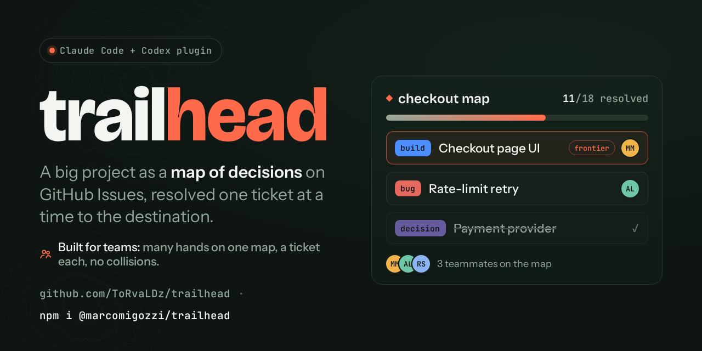
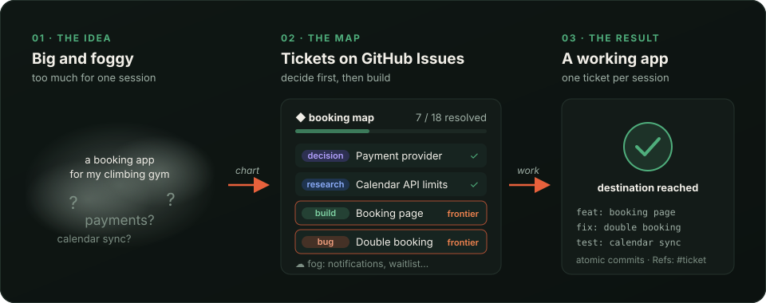
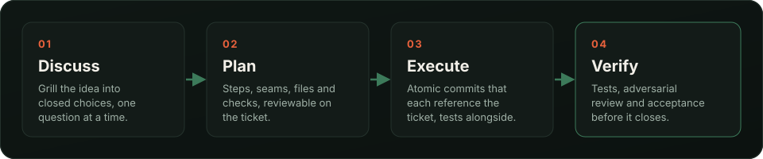
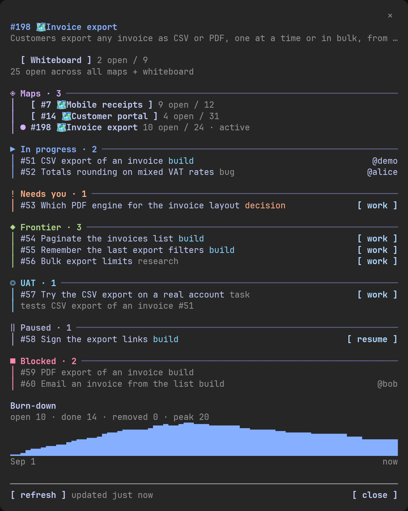
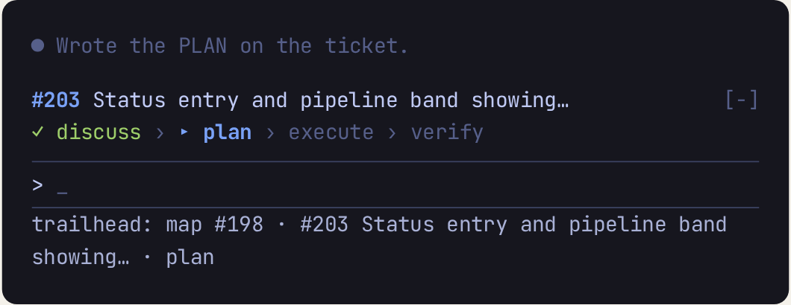

<div align="center">



🇬🇧 [English](README.md) · 🇮🇹 **Italiano**

[](https://trailhead.marcomigozzi.it) [](https://www.npmjs.com/package/@marcomigozzi/trailhead) [](LICENSE)   

### Il tuo coding agent è bravissimo su un ticket.<br>trailhead gli dà l'intero progetto.

**Avvia e conduci grandi progetti come una mappa di ticket su GitHub Issues,<br>risolvendone uno alla volta finché la via verso la destinazione non è chiara.**

[**Documentazione**](https://trailhead.marcomigozzi.it/docs/) · [Primi passi](https://trailhead.marcomigozzi.it/docs/getting-started) · [Comandi](https://trailhead.marcomigozzi.it/docs/commands) · [Changelog](CHANGELOG.md)

<br>



</div>

<br>

## 🧭 Il problema che risolve

Un progetto vero non sta in una sessione di un agente. Chiedi «tutta l'app» e ottieni un'ipotesi detta con sicurezza; la spezzi tu e diventi il project manager, la memoria e la colla.

<table>
<tr>
<th width="50%">😵 Senza trailhead</th>
<th width="50%">🗺️ Con trailhead</th>
</tr>
<tr>
<td>L'agente <b>indovina</b> le decisioni importanti e te ne accorgi tre file dopo.</td>
<td>Le decisioni sono <b>ticket</b>: le opzioni sul tavolo, poi un grilling, una domanda alla volta, finché scegli <b>tu</b>.</td>
</tr>
<tr>
<td>Il piano vive in una chat che <b>finisce</b>, o in note locali che nessun altro vede.</td>
<td>Il piano vive su <b>GitHub Issues</b>: la mappa, la discussione, il piano e la verifica, visibili a tutto il team.</td>
</tr>
<tr>
<td>Ogni sessione riparte da <b>zero</b>: cosa si è deciso, cosa manca, cosa viene dopo?</td>
<td>La <b>frontier</b> dice cosa si può prendere adesso; <code>/trailhead:work</code> lo prende con tutto il contesto.</td>
</tr>
<tr>
<td>Due agenti nello stesso checkout si <b>sovrascrivono</b> a vicenda.</td>
<td>Assegnarsi un ticket lo <b>prenota</b>, e ogni sessione concorrente ha il suo worktree o clone.</td>
</tr>
<tr>
<td>«Fatto» vuol dire «<b>compila</b>».</td>
<td>Fatto vuol dire <b>verificato</b>: test, review avversariale e accettazione prima che il ticket si chiuda.</td>
</tr>
</table>

<br>

## ✨ Cosa ottieni

<table>
<tr>
<td width="33%" valign="top">

### 🗺️ Una mappa, non una lista
Un'idea grande diventa una issue mappa con un ticket figlio per ogni decisione, domanda di ricerca e pezzo di lavoro. Ciò che non sai ancora formulare aspetta nella **fog** finché le risposte precedenti non la diradano.

</td>
<td width="33%" valign="top">

### ⚙️ Il motore giusto per ogni ticket
Una **decisione** si sceglie con un grilling, una **ricerca** raccoglie un fatto, una **build** si pianifica e si costruisce, un **bug** si riproduce prima di correggerlo.

</td>
<td width="33%" valign="top">

### 🤖 Dagli una mappa, torna dopo
`/trailhead:auto` lavora una mappa senza presidio, fino a quattro slot in parallelo, e lascia un report, i ticket che hanno bisogno di te e i commit da pushare.

</td>
</tr>
<tr>
<td valign="top">

### 👥 Fatto per i team
Persone e agenti condividono una frontier, un ticket a testa. Metti in pausa, riprendi o dividi un ticket, e porta avanti più mappe affiancate.

</td>
<td valign="top">

### 🎨 Mockup e accettazione
Vedi la schermata prima che venga scritta, e chiudi una funzionalità solo dopo averla provata come farebbe un utente.

</td>
<td valign="top">

### 🛡️ Self-contained, con le guardie
Niente altro da installare: trailhead ha i propri agent del motore e dieci hook di guardia, su Claude Code e Codex CLI.

</td>
</tr>
</table>

<br>

## ⚙️ Come si costruisce un ticket

Ogni ticket build percorre lo stesso ciclo disciplinato, e ogni passo è un commento sul ticket, così il ragionamento resta accanto al lavoro.



<br>

## 🖥️ Dal vivo in Claude Code

La mod inclusa mette la mappa accanto alla conversazione: i tuoi ticket in corso, ciò che aspetta te e la frontier con un pulsante `work` per ogni ticket. Una banda sopra il prompt mostra il ticket in gioco, e la sessione prende il suo nome.

<table>
<tr>
<td width="58%" valign="top"></td>
<td width="42%" valign="top">

<br><br>
<b>📍 Sai sempre dove sei.</b> La banda mostra il ticket in gioco e il suo step: discuss, plan, execute, verify.
<br><br>
<b>▶️ Si parte con un clic.</b> Ogni ticket della frontier ha un pulsante <code>work</code> che pulisce il contesto e lo avvia.
<br><br>
<b>📉 Lo vedi calare.</b> Il burn-down segue i ticket aperti dal primo fino alla destinazione.
</td>
</tr>
</table>

<br>

## 🚀 Per iniziare

Ti servono la [`gh` CLI](https://cli.github.com) autenticata e un repo GitHub.

```bash
# Plugin Claude Code
/plugin marketplace add ToRvaLDz/trailhead
/plugin install trailhead@trailhead

# oppure con npm, per Claude Code o Codex CLI (Node 18+)
npx @marcomigozzi/trailhead
```

Poi riavvia l'agente e dagli una destinazione:

```bash
/trailhead:new "un'app di prenotazione per la mia palestra di arrampicata"   # traccia una mappa da un'idea
/trailhead:adopt                                                            # o adotta un codebase esistente
/trailhead:work                                                             # lavora il prossimo ticket della frontier
```

Su Codex il punto d'ingresso è `$trailhead`. Tutte le opzioni sono in [Getting started](https://trailhead.marcomigozzi.it/docs/getting-started).

<br>

## 📚 Per saperne di più

La documentazione è in inglese.

<table>
<tr>
<td>🧠 <a href="https://trailhead.marcomigozzi.it/docs/concepts"><b>Core concepts</b></a><br><sub>mappe, frontier, fog, ancore</sub></td>
<td>🔄 <a href="https://trailhead.marcomigozzi.it/docs/workflow"><b>Workflow</b></a><br><sub>il ciclo di vita e un esempio completo</sub></td>
<td>⌨️ <a href="https://trailhead.marcomigozzi.it/docs/commands"><b>Commands</b></a><br><sub>tutti i 24 verbi</sub></td>
</tr>
<tr>
<td>👥 <a href="https://trailhead.marcomigozzi.it/docs/teamwork"><b>Working as a team</b></a><br><sub>prenotazione, isolamento, cattura dalla CI</sub></td>
<td>🎨 <a href="https://trailhead.marcomigozzi.it/docs/design"><b>Design mockups</b></a><br><sub>vederlo prima di costruirlo</sub></td>
<td>⚙️ <a href="https://trailhead.marcomigozzi.it/docs/configuration"><b>Configuration</b></a><br><sub>modelli, TDD, isolamento</sub></td>
</tr>
</table>

<br>

## 🙏 Ringraziamenti

trailhead unisce due idee che risolvono ciascuna metà del problema: una mappa di decisioni per *avviare* un progetto e un motore disciplinato per *costruirlo*. È una metodologia originale e self-contained **ispirata da** esse. Non copia né ridistribuisce il loro codice, e non invoca nessuna delle loro skill; reimplementa le idee come propri protocolli inline:

- **[Matt Pocock](https://www.aihero.dev)**: per **Wayfinder**, il cui modello map / frontier / fog-of-war è la spina dorsale della metà di pianificazione di trailhead, e le cui skill `grilling`, `domain-modeling`, `prototype`, `research` e `tdd` hanno plasmato le tecniche inline di trailhead. Vedi [`mattpocock/skills`](https://github.com/mattpocock/skills).
- **Il team [open-gsd](https://github.com/open-gsd/gsd-core)**: per **GSD**, il cui ciclo `discuss → plan → execute → verify`, il modello di cattura, il codebase mapping e il debugging sistematico sono il motore della metà di costruzione di trailhead.

Grazie. Se ti piacciono queste idee, metti una star e usa gli originali: vanno molto più in profondità dei protocolli compatti di trailhead.

<div align="center">
<br>

MIT © Marco Migozzi ([@ToRvaLDz](https://github.com/ToRvaLDz)) · [trailhead.marcomigozzi.it](https://trailhead.marcomigozzi.it)

</div>
