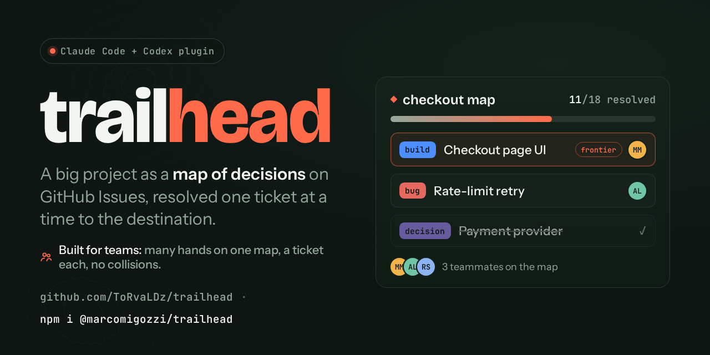
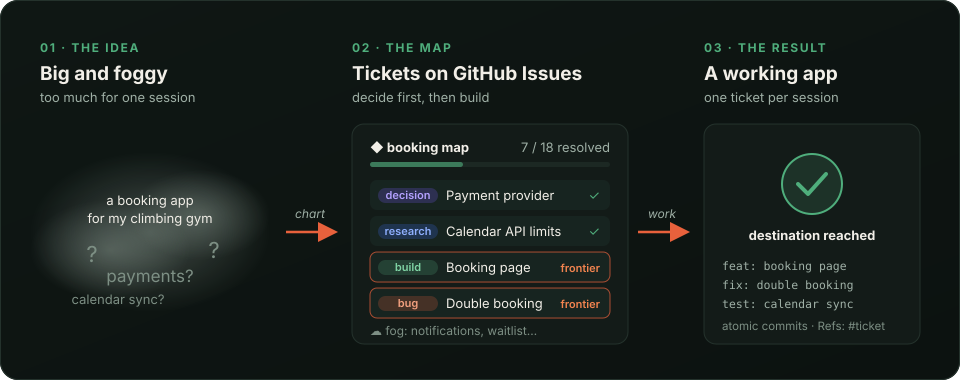
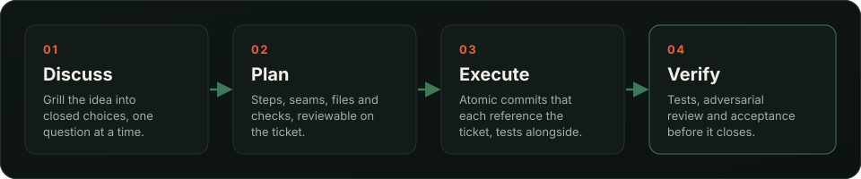
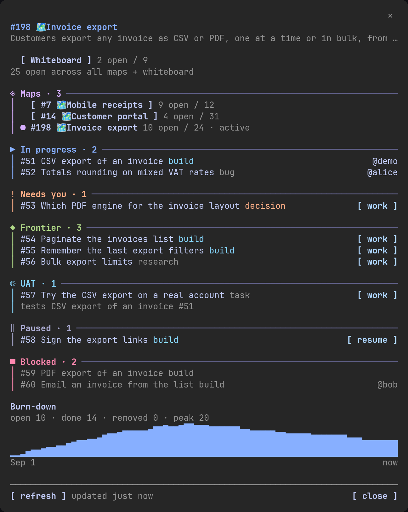
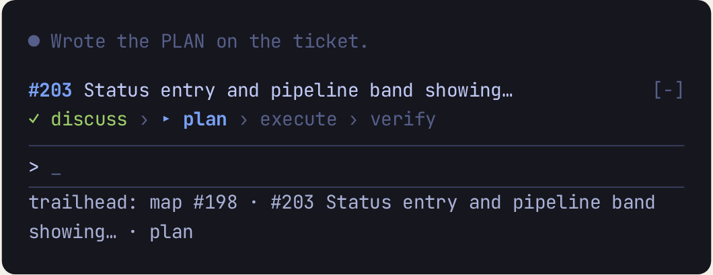

<div align="center">



🇬🇧 **English** · 🇮🇹 [Italiano](README.it.md)

[](https://trailhead.marcomigozzi.it) [](https://www.npmjs.com/package/@marcomigozzi/trailhead) [](LICENSE)   

### Your coding agent is brilliant at one ticket.<br>trailhead gives it the whole project.

**Start and drive large projects as a map of tickets on GitHub Issues,<br>resolving one at a time until the way to the destination is clear.**

[**Documentation**](https://trailhead.marcomigozzi.it/docs/) · [Getting started](https://trailhead.marcomigozzi.it/docs/getting-started) · [Commands](https://trailhead.marcomigozzi.it/docs/commands) · [Changelog](CHANGELOG.md)

<br>



</div>

<br>

## 🧭 The problem it solves

A real project doesn't fit in one agent session. Ask for "the whole app" and you get a confident guess; split it yourself and you become the project manager, the memory and the glue.

<table>
<tr>
<th width="50%">😵 Without trailhead</th>
<th width="50%">🗺️ With trailhead</th>
</tr>
<tr>
<td>The agent <b>guesses</b> the big decisions and you find out three files later.</td>
<td>Decisions are <b>tickets</b>: options laid out, then a grilling, one question at a time, until <b>you</b> choose.</td>
</tr>
<tr>
<td>The plan lives in a chat that <b>ends</b>, or in local notes nobody else sees.</td>
<td>The plan lives on <b>GitHub Issues</b>: the map, the discussion, the plan and the verification, visible to the whole team.</td>
</tr>
<tr>
<td>Every session starts from <b>zero</b>: what was decided, what's left, what's next?</td>
<td>The <b>frontier</b> says what's takeable now; <code>/trailhead:work</code> picks it up with all the context.</td>
</tr>
<tr>
<td>Two agents in one checkout <b>overwrite</b> each other.</td>
<td>Assigning a ticket <b>claims</b> it, and each concurrent session gets its own worktree or clone.</td>
</tr>
<tr>
<td>"Done" means "<b>it compiled</b>".</td>
<td>Done means <b>verified</b>: tests, adversarial review and acceptance before the ticket closes.</td>
</tr>
</table>

<br>

## ✨ What you get

<table>
<tr>
<td width="33%" valign="top">

### 🗺️ A map, not a list
A big idea becomes one map issue with a child ticket for each decision, research question and piece of work. What you can't phrase yet waits in the **fog** until earlier answers clear it.

</td>
<td width="33%" valign="top">

### ⚙️ The right engine per ticket
A **decision** is grilled to a choice, **research** gathers a fact, a **build** is planned and built, a **bug** is reproduced before it's fixed.

</td>
<td width="33%" valign="top">

### 🤖 Hand it a map, come back
`/trailhead:auto` works a map unattended, in up to four parallel slots, and leaves a report, the tickets that need you, and commits to push.

</td>
</tr>
<tr>
<td valign="top">

### 👥 Built for teams
Many people and agents share one frontier, one ticket each. Pause, resume or split a ticket, and run several maps side by side.

</td>
<td valign="top">

### 🎨 Mockups and acceptance
See the screen before it's coded, and close a feature only after it was tried the way a user would.

</td>
<td valign="top">

### 🛡️ Self-contained, with guardrails
Nothing else to install: trailhead ships its own engine agents and ten guardrail hooks, on Claude Code and Codex CLI.

</td>
</tr>
</table>

<br>

## ⚙️ How a ticket gets built

Every build ticket walks the same disciplined cycle, and every step is a comment on the ticket, so the reasoning stays next to the work.



<br>

## 🖥️ Live in Claude Code

The bundled mod puts the map beside the conversation: your tickets in progress, what needs you, and the frontier with a `work` button per ticket. A band above the prompt shows the ticket in play, and the session is named after it.

<table>
<tr>
<td width="58%" valign="top"></td>
<td width="42%" valign="top">

<br><br>
<b>📍 Always know where you are.</b> The band shows the ticket in play and its step: discuss, plan, execute, verify.
<br><br>
<b>▶️ One click to start.</b> Each frontier ticket has a <code>work</code> button that clears the context and starts it.
<br><br>
<b>📉 See it shrink.</b> The burn-down tracks the open tickets from the first one to the destination.
</td>
</tr>
</table>

<br>

## 🚀 Get started

You need an authenticated [`gh` CLI](https://cli.github.com) and a GitHub repo.

```bash
# Claude Code plugin
/plugin marketplace add ToRvaLDz/trailhead
/plugin install trailhead@trailhead

# or with npm, for Claude Code or Codex CLI (Node 18+)
npx @marcomigozzi/trailhead
```

Then restart your agent and give it a destination:

```bash
/trailhead:new "a booking app for my climbing gym"   # chart a map from a loose idea
/trailhead:adopt                                     # or adopt an existing codebase
/trailhead:work                                      # work the next ticket on the frontier
```

On Codex the entry point is `$trailhead`. Every option is in [Getting started](https://trailhead.marcomigozzi.it/docs/getting-started).

<br>

## 📚 Learn more

<table>
<tr>
<td>🧠 <a href="https://trailhead.marcomigozzi.it/docs/concepts"><b>Core concepts</b></a><br><sub>maps, frontier, fog, anchors</sub></td>
<td>🔄 <a href="https://trailhead.marcomigozzi.it/docs/workflow"><b>Workflow</b></a><br><sub>the lifecycle and a worked example</sub></td>
<td>⌨️ <a href="https://trailhead.marcomigozzi.it/docs/commands"><b>Commands</b></a><br><sub>all 24 verbs</sub></td>
</tr>
<tr>
<td>👥 <a href="https://trailhead.marcomigozzi.it/docs/teamwork"><b>Working as a team</b></a><br><sub>claiming, isolation, CI capture</sub></td>
<td>🎨 <a href="https://trailhead.marcomigozzi.it/docs/design"><b>Design mockups</b></a><br><sub>see it before it's built</sub></td>
<td>⚙️ <a href="https://trailhead.marcomigozzi.it/docs/configuration"><b>Configuration</b></a><br><sub>models, TDD, isolation</sub></td>
</tr>
</table>

<br>

## 🙏 Acknowledgements

trailhead joins two ideas that each nail one half of the problem: a map of decisions to *start* a project, and a disciplined engine to *build* it. It is an original, self-contained methodology **inspired by** them. It does not copy or redistribute their code, and it invokes none of their skills; it reimplements the ideas as its own inline protocols:

- **[Matt Pocock](https://www.aihero.dev)**: for **Wayfinder**, whose map / frontier / fog-of-war model is the backbone of trailhead's planning half, and whose `grilling`, `domain-modeling`, `prototype`, `research`, and `tdd` skills shaped trailhead's inline techniques. See [`mattpocock/skills`](https://github.com/mattpocock/skills).
- **The [open-gsd](https://github.com/open-gsd/gsd-core) team**: for **GSD**, whose `discuss → plan → execute → verify` cycle, capture model, codebase mapping, and systematic debugging are the engine of trailhead's building half.

Thank you. If you like the ideas here, go star and use the originals: they go far deeper than trailhead's compact protocols.

<div align="center">
<br>

MIT © Marco Migozzi ([@ToRvaLDz](https://github.com/ToRvaLDz)) · [trailhead.marcomigozzi.it](https://trailhead.marcomigozzi.it)

</div>
