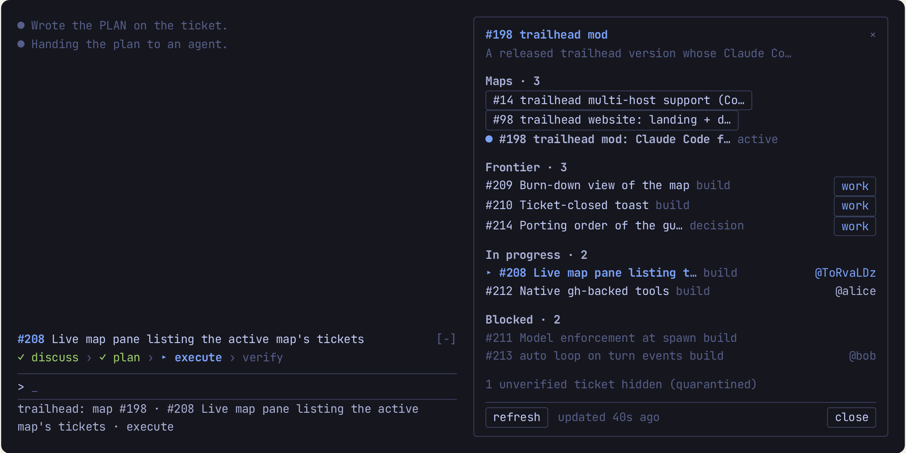
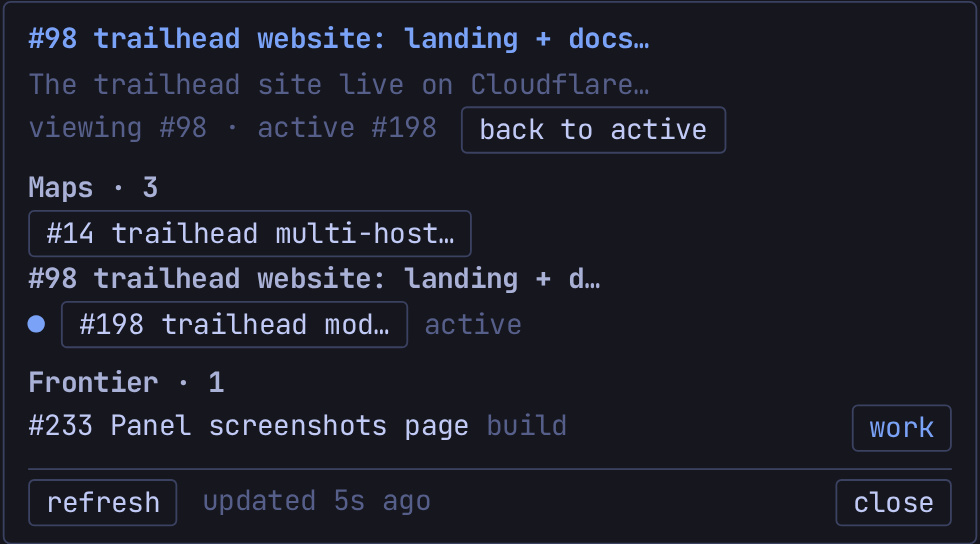
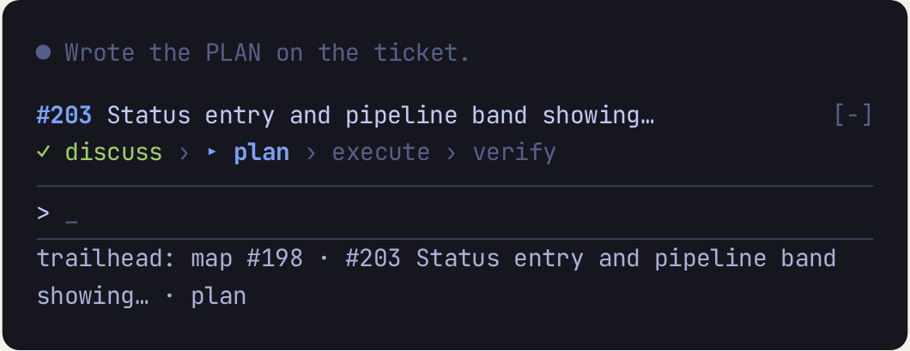

The view verbs present state. They change nothing on the tracker, with a few exceptions noted per verb: the dashboard's create-and-pin self-heal, and a map close that only happens on your explicit yes. No isolation workspace is set up for them. Back to the [command index](/docs/commands).

### /trailhead:map

Show the low-res map: destination, decisions, frontier, fog.

**Syntax**

```
/trailhead:map [map]
```

**Arguments**

- `map` (optional): a map number. `/trailhead:map <n>` shows that map and makes it the active one. Without it, trailhead uses the active map (`.trailhead/active-map`); with no active map and more than one open, it lists them and asks.

**What it does**

1. Makes sure the repo's pinned dashboard exists and is pinned (see `dashboard` below), creating or re-pinning it only if needed.
2. Renders the map by name: Destination; Frontier (takeable now, each with its type, shown as a set to choose from rather than a ranked list; whiteboard tickets and paused tickets are excluded); In progress (with who holds each); Paused (tickets set aside on a `PAUSED` checkpoint, with the holder if any; `/trailhead:resume <n>` takes one back); Blocked (with what each waits on, and an advisory line if the written `## Blocked by` differs from the native dependency); Decisions so far; Not yet specified and parked fog (each top-level fog entry numbered for that render so you can name one); Out of scope; and an inbox count.
3. Flags any Out of scope line that is really deferred (a gate, a "for now" qualifier, a feature wanted later) and suggests `/trailhead:inbox` to re-route it.
4. If the map is exhausted (no open tickets and no fog left), says so and asks whether to close the map issue. A yes closes it and refreshes the dashboard; a no leaves it open. It never closes unprompted.

**What it writes**

- Nothing on the map, except the map close when you say yes. The fog numbers are a render-time handle and are never saved into the map body.
- The dashboard, only if it was missing (created and pinned) or unpinned (re-pinned); never a body rewrite on a render.
- With `<n>`, the local `.trailhead/active-map` marker.

**Example**

```
/trailhead:map
```

trailhead prints the destination, the frontier tickets you could take now, who holds what, the blocked ones, the settled decisions and the numbered fog.

### /trailhead:dashboard

Show the repo dashboard: the pinned index of every open map, the whiteboard, and live counts.

**Syntax**

```
/trailhead:dashboard
```

**Arguments**

None.

**What it does**

1. Finds the repo's `trailhead:dashboard` issue, creating and pinning it if missing (it takes the fixed third pinned slot beside the codebase and conventions issues).
2. Regenerates its body from the live tracker and shows it: a link to every open map (GitHub renders each map's progress bar natively), the whiteboard section (Frontier, In progress, Paused, Blocked and Unverified groups; a paused ticket shows once, under Paused, and is not counted in the whiteboard frontier), and counts such as the untriaged inbox size and the whiteboard frontier size.
3. Flags each open map that is exhausted but still open as `exhausted · closeable` and offers to close it, routing any deferred Out of scope line first. It flags a map near GitHub's 100 sub-issue cap as `near cap · <total>/100` (or `at cap`, with `· prunable` when closed edges can be reclaimed) and offers `/trailhead:prune`. Both are offers only, never automatic.

**What it writes**

- The pinned dashboard issue body, as a full regeneration (the on-demand refresh). A hidden `trailhead:last-audit` marker already in the body is preserved, since `/trailhead:audit` uses it.
- The dashboard otherwise refreshes on structural events (a map charted or exhausted, a whiteboard ticket born or resolved), not on every map ticket resolve.

**Example**

```
/trailhead:dashboard
```

trailhead refreshes the pinned index and shows two open maps, the whiteboard with three loose tickets, and a note that one map is `exhausted · closeable`, with an offer to close it.

### /trailhead:whiteboard

Show the whiteboard: loose, map-less tickets, their frontier and who holds each.

**Syntax**

```
/trailhead:whiteboard
```

**Arguments**

None.

**What it does**

1. Makes sure the pinned dashboard exists and is pinned (same self-heal as `map`).
2. Renders the whiteboard by name: Frontier (open, unassigned, unblocked, not paused `trailhead:whiteboard` tickets, each with its type, as a set to choose from), In progress (claimed tickets and who holds each), Paused (tickets set aside on a `PAUSED` checkpoint; `/trailhead:resume <n>` takes one back), and Blocked (with what each waits on). Unlike a map it has no destination, decisions or fog: it holds only loose work.
3. Pick a frontier ticket with `/trailhead:work <n>` (works it whole and can split) or `/trailhead:quick <n>` (no split).

**What it writes**

Nothing. It is a read-only render; the dashboard is touched only if it was missing or unpinned.

**Example**

```
/trailhead:whiteboard
```

trailhead lists, for example, a `todo` and a `bug` on the frontier, one ticket in progress under a teammate, and one blocked ticket with its blocker.

### /trailhead:panel

Open or close the live map panel: the active map's open tickets by state, refreshed as the work moves. Claude Code only: the panel is drawn by the trailhead mod (Claude Code 2.1.287+ with the trailhead plugin), so on Codex and in a session without the mod the command answers that the panel is not available.



**Syntax**

```
/trailhead:panel
```

**Arguments**

None.

**What it does**

1. Toggles the panel: it opens when closed (`Map panel opened.`) and closes when open (`Map panel closed.`). If the terminal is too narrow to place it, the answer says why.
2. Shows the active map (`.trailhead/active-map`) as a link with its destination, then its open tickets grouped as Needs you, Frontier, In progress, UAT, Paused and Blocked, each with its count. A ticket an autonomous run parked for you (it carries `trailhead:needs-you`) appears once, under Needs you at the top, whatever its other state, with its `work` button or holder. A pending UAT follow-up (it carries `trailhead:uat`) appears once, under UAT (unless it also carries `trailhead:needs-you`), with a dim `tests <parent> #n` line naming the ticket it tests and its usual `work` button or holder. A paused ticket (it carries `trailhead:paused`) appears only under Paused (unless it also carries `trailhead:needs-you`), with its holder when assigned and no `work` button. A row is `#n title` (a link to the issue) and its type; every assigned row shows its holder as `@login`, and the ticket in play in this session is marked `▸` and says `this session` in place of its holder, even when another session shares the work-state file. A tracker ticket marked unverified is never listed, only counted in one dim line. With more than one open map, a `Maps · n` list sits under the header with the active map marked `●`; a click on another map only views it (`viewing #n · active #m`, with a `back to active` button). With no active map, the open maps are listed to view. A `Whiteboard` row above the maps list (shown even with a single map, its `N open / M` counts beside it, name-only when the counts cannot be read) switches to the dashboard view: a `Dashboard` title (a link to the pinned `trailhead:dashboard` issue), every open map as a button that opens it, and the whiteboard's open tickets grouped as Needs you, Frontier, In progress, UAT, Paused and Blocked with the same `work` buttons; `map` returns to the map shown before.

   

3. Each Frontier row has a `work` button that clears the conversation (`/clear`) and then runs `/trailhead:work <n>`; while a turn is running it is queued behind it and the row shows `queued`.
4. A Burn-down section at the bottom shows the map's open tickets over time, with the counts `open · done · removed · peak`: a chart on the terminal, a one-row sparkline on the desktop app. If the read fails it keeps the last curve and shows its age.

   

5. Refreshes from the tracker on session start, turn end, a Bash `gh issue` write, the `refresh` button and a slow timer, never more than once every 15 seconds and never while the panel is closed. If `gh` fails it keeps the last list and shows one dim reason with the age of that list.
6. The footer has `refresh` and the status on the left and `close` on the right; a status too long to fit beside the buttons moves to a row of its own. `close` closes the panel like closing it by hand, so it never opens by itself again that session.
7. In fullscreen, opens by itself once when a map is active; it never opens by itself on the main screen, and never again after you close it.

**Also on screen**

The same mod draws a pipeline band above the prompt (the ticket in play and its discuss › plan › execute › verify step) and a `trailhead:` status entry under it, whenever a ticket is in play.



**What it writes**

Nothing. It only reads the tracker through `gh`; the only thing it runs is `/trailhead:work <n>` when you press `work`.

**Example**

```
/trailhead:panel
```

trailhead answers `Map panel opened.` and docks the panel beside the transcript, with the frontier tickets of the active map, who holds each in progress, and the blocked ones.

Next: [capture commands](/docs/commands/capture) for adding to the map or the whiteboard in one line. See also [Captures & the whiteboard](/docs/captures).
